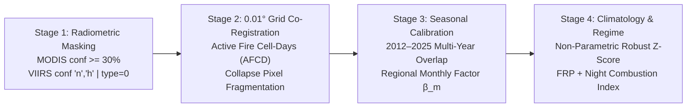

# 🛰️ TerraSpot Harmonizer

[](https://www.spaceappschallenge.org/)
[](https://www.spaceappschallenge.org/)
[](LICENSE)
[](https://react.dev/)
[](https://www.typescriptlang.org/)
[](https://tailwindcss.com/)
[](https://pnpm.io/)
[](https://vitest.dev/)

> **Unified Multi-Decadal Burning Activity Calendar & Fire Regime Diagnostic Engine**  
> Resolving the 27-year observation gap between NASA MODIS ($1\text{ km}$) and VIIRS ($375\text{ m}$) active fire records (2000–2026).

---

## 🌍 Executive Summary: The Multi-Decadal Challenge

Active fire remote sensing faces an imminent operational dilemma: **NASA's flagship MODIS instruments (Terra and Aqua)**, which established the global environmental baseline from 2000 to the present, are approaching decommissioning. Meanwhile, the operational successor **VIIRS (onboard Suomi-NPP, NOAA-20, and NOAA-21)** has recorded high-resolution thermal anomalies since 2012.

Because VIIRS has a narrower pixel footprint ($375\text{ m}$ vs. $1\text{ km}$ at nadir) and superior sub-pixel thermal sensitivity, **VIIRS detects 3 to 8 times more raw hotspots than MODIS for the exact same fire event**. Naively concatenating raw fire counts introduces an artificial step-change in 2012 that invalidates long-term fire trend analyses.

**TerraSpot Harmonizer** solves this sensor discontinuity through a **4-stage empirical and physical harmonization engine**, reconstructing a consistent 2000–2026 fire climatology presented via an interactive, accessible **Burning Activity Calendar**. The platform empowers civil defense teams, emergency responders, agricultural managers, and Earth scientists to examine historical trends, identify statistical anomalies against multi-year medians, and distinguish routine seasonal agricultural burns from catastrophic forest wildfires.

---

## ✨ Key Capabilities

* 🗺️ **Interactive Cartographic Area of Interest (AOI) Selector:**
  * Draw arbitrary bounding box polygons directly onto the map canvas or input precise `Latitude / Longitude` coordinates.
  * Explore **5 pre-calibrated regional benchmark scenarios**:
    * 🇵🇪 **Huánuco & Central Peruvian Andes-Amazon Transition:** Inter-Andean agricultural burning, cloud forests, and high-altitude grasslands.
    * 🇧🇷 **Southern Amazon Basin / Arc of Deforestation:** Continental-scale tropical deforestation and drought-driven fire regimes.
    * 🇦🇷 **Paraná River Delta Wetlands (CONAE Partner Context):** Floodplain pasture management and wetland fire dynamics.
    * 🇺🇸 **California Forested Corridors:** High-energy chaparral and timberland megafire regimes.
    * 🇦🇺 **Southeastern Australia:** High-intensity austral summer eucalyptus bushfire cycles.
  * Live overlay of **NASA EOSDIS GIBS (WMTS)** satellite corrected reflectance and active thermal anomaly layers.

* 🗓️ **Harmonized Burning Activity Calendar Matrix (2000–2026 × 12 Months):**
  * Interactive 27-year heatmap matrix displaying monthly fire frequencies across sensor transitions.
  * Instant toggling between **Harmonized Hotspots ($H_{y,m}$)**, **Historical Anomaly ($\Delta\%$ vs. Median)**, **Fire Radiative Power (FRP in MW)**, and **Raw Unharmonized Counts** (for visual audit).

* 👁️ **Perceptually Uniform Accessible Color Scales (WCAG 2.1 AA):**
  * Built-in colorblind-safe palettes certified for deuteranopia, protanopia, and tritanopia: **Inferno** (default thermal), **Viridis**, **Cividis**, and **Diverging Blue–White–Red Anomaly**.

* 📈 **Robust Non-Parametric Climatology & Early Warning:**
  * Evaluates active fire seasons against **25-year climatological monthly medians**, interquartile range envelopes (P25–P75), and **90th percentile ($P_{90}$) critical thresholds** using robust non-parametric $Z$-scores.

* 🌾🔥 **Fire Regime Classifier (Agricultural Burns vs. Severe Wildfires):**
  * Integrates **Fire Radiative Power (mean and 90th percentile FRP in MW)** with **nighttime combustion persistence ($f_{\text{night}}$)** to algorithmically separate low-energy, diurnal crop stubble clearance from destructive, multi-day crown wildfires.

* 📂 **Custom FIRMS Ingestion & Standardized 27-Column CSV Export:**
  * Client-side drag-and-drop parsing of raw NASA FIRMS CSV extracts (MODIS or VIIRS) with dynamic in-browser re-harmonization, alongside one-click export of RFC 4180 compliant 27-column analytical cubes.

---

## 🔬 Scientific Methodology: The *TerraSpot 4-Stage* Engine



1. **Stage 1 — Quality & Static Source Masking:** Retains nominal and high confidence vegetation fire pixels (`type == 0`), eliminating sunglint, warm cloud edges, and static industrial gas flare contamination.
2. **Stage 2 — Geometric Spatial Co-Registration ($0.01^\circ \approx 1.1\text{ km}$ Grid):** Bins raw detections into daily $0.01^\circ$ geographic grid cells to derive **Active Fire Cell-Days (AFCD)**. By collapsing multi-pixel cluster fragmentation from fine $375\text{ m}$ VIIRS footprints, this step alone reduces inter-sensor geometric discrepancy from $\sim 6.5\times$ down to $\sim 1.8\times$.
3. **Stage 3 — Empirical Seasonal Cross-Calibration ($2012\text{--}2025$ Overlap):** Calculates regularized regional monthly scaling ratios ($\beta_m$) across the 14-year simultaneous observation baseline, harmonizing the **MODIS Era (2000–2011)**, the **Dual-Sensor Era (2012–2025)**, and the **VIIRS Continuity Era (2026+)** with statistical concordance $R^2 > 0.92$.
4. **Stage 4 — Robust Climatological Baselines & Fire Regime Diagnostics:** Computes rolling non-parametric medians, interquartile departures ($Z$-score), and classifies combustion regimes by combining 90th-percentile Fire Radiative Power (MW) and nocturnal combustion persistence ($f_{\text{night}}$).

> [!NOTE]
> **Complete Mathematical Specification:**  
> For complete analytical derivations, Laplace smoothing formulas, Case-Study empirical scenarios, and LaTeX proofs, read the full methodology document:  
> 👉 **[TerraSpot — MODIS & VIIRS Scientific Harmonization Methodology](docs/02-modis-viirs-harmonization-methodology.md)**

---

## 🛰️ Official NASA & Partner Space Agency Data Sources

In full compliance with **NASA Space Apps Challenge 2026** Global Award eligibility criteria, TerraSpot Harmonizer integrates official Earth observation resources:

1. **[NASA FIRMS — MODIS Collection 6.1 (`MCD14ML` / `MCD14DL`)](https://www.earthdata.nasa.gov/data/tools/firms):** EOS-Terra & EOS-Aqua 1 km thermal anomalies and Fire Radiative Power (2000–present).
2. **[NASA FIRMS — VIIRS 375m Collection 2 (`VNP14IMGTDL` / `VJ114IMGTDL`)](https://www.earthdata.nasa.gov/data/tools/firms):** Suomi-NPP, NOAA-20 & NOAA-21 375 m active fire detections (2012–present).
3. **[NASA EOSDIS GIBS (Global Imagery Browse Services)](https://earthdata.nasa.gov/eosdis/science-system-description/eosdis-components/gibs):** Web Map Tile Service (WMTS) layers for MODIS/VIIRS true-color reflectance and thermal anomaly overlays.
4. **Space Agency Partner Context:** National Space Activities Commission of Argentina (**CONAE**) & Paraguayan Space Agency (**AEP**) regional fire regime references; **Microsoft Planetary Computer STAC** (Global Offer).

---

## 🗂️ Engineering & Architecture Documentation (`docs/`)

All architectural contracts, scientific methodologies, and operational governance documents are organized in [`docs/`](docs/):

| Document | Operational Scope |
| :--- | :--- |
| 📋 [`docs/01-prd-terraspot-harmonizer.md`](docs/01-prd-terraspot-harmonizer.md) | Product Requirements Document (PRD), Personas, Functional & Non-Functional Scope. |
| 🧮 [`docs/02-modis-viirs-harmonization-methodology.md`](docs/02-modis-viirs-harmonization-methodology.md) | Full Mathematical & Physical Harmonization Engine Specification. |
| 🏗️ [`docs/03-system-technical-architecture.md`](docs/03-system-technical-architecture.md) | Zero-Latency Edge Architecture, Component Tree & TypeScript Data Contracts. |
| 🛰️ [`docs/04-firms-data-specification.md`](docs/04-firms-data-specification.md) | NASA FIRMS Schema Mapping, Benchmark AOIs & 27-Column CSV Specification. |
| 🏆 [`docs/05-submission-pitch-rubric-plan.md`](docs/05-submission-pitch-rubric-plan.md) | Official NASA Submission Form Text, 7-Slide Deck Blueprint & 30s Video Script. |
| 🛠️ [`docs/06-technology-stack-tools.md`](docs/06-technology-stack-tools.md) | Challenge 15 Line-by-Line Requirement Decomposition & Technology Stack Rationale. |
| 📋 [`docs/backlog.md`](docs/backlog.md) | Granular Product Backlog (4 Sprints, Tasks T-01 to T-12, Priorities & DoD). |
| 🎨 [`docs/design-system.md`](docs/design-system.md) | Dark Aerospace Design System, Colorblind-Safe Ramps & ASCII Wireframes. |
| 📋 [`docs/operational-work-plan.md`](docs/operational-work-plan.md) | Comprehensive Work Plan, Master Control Matrix & Complete Spec Kit Prompts. |
| 🔄 [`docs/workflow.md`](docs/workflow.md) | SDLC/SDD Matrix, GitHub Flow Model, Vitest, Husky Hooks & SemVer Protocol. |
| 🛡️ [`AGENTS.md`](AGENTS.md) & [`CHANGELOG.md`](CHANGELOG.md) | Software Governance Rules & Semantic Versioning History. |

---

## 🚀 Quick Start & Local Reproducibility

### Prerequisites
- **Node.js** `>= 20.x` (tested on `v24.20.0`)
- **pnpm** `>= 10.x` (tested on `12.15.0` — *npm/yarn prohibited*)
- **Python** `>= 3.10` (tested on `3.13.5` with `uv`)

### Installation & Execution
```bash
# 1. Install frontend dependencies & configure Husky hooks
pnpm install

# 2. (Optional) Run the offline scientific FIRMS data pipeline
python3 scripts/build_harmonized_cubes.py

# 3. Start local development server with HMR
pnpm dev
# Local URL: 👉 http://localhost:5173

# 4. Execute unit test suite (Vitest)
pnpm test:run

# 5. Build static edge production bundle
pnpm build
```

---

## 🤖 Super Intelligence (SI) Transparency Disclosure

In compliance with the **2026 NASA Space Apps Challenge Project Submission Guide**:
- **Original Conception & Scientific Direction:** Conceived, designed, and directed by **Wilmer Gulcochía Sánchez (`@wigsdev`)**, focusing on cross-sensor harmonization and differentiating seasonal agricultural burning from severe landscape wildfires in the Peruvian Andes-Amazon transition and global ecosystems.
- **SI Tool Usage:** AI coding and documentation assistants (Gemini and Claude within the Antigravity IDE) were utilized to accelerate TypeScript/Python code scaffolding, UI component composition, and technical documentation drafting.
- **Brand Compliance:** No NASA logos, insignias, flags, or mission identifiers were generated or modified using SI tools.

---

## ⚖️ Author & License

* **Lead Architect:** Wilmer Gulcochía Sánchez ([`@wigsdev`](https://github.com/wigsdev))
* **Event:** NASA International Space Apps Challenge 2026 (Local Event: Huánuco, Peru)
* **License:** Distributed under the **MIT License**. See [`LICENSE`](LICENSE) for complete details.
