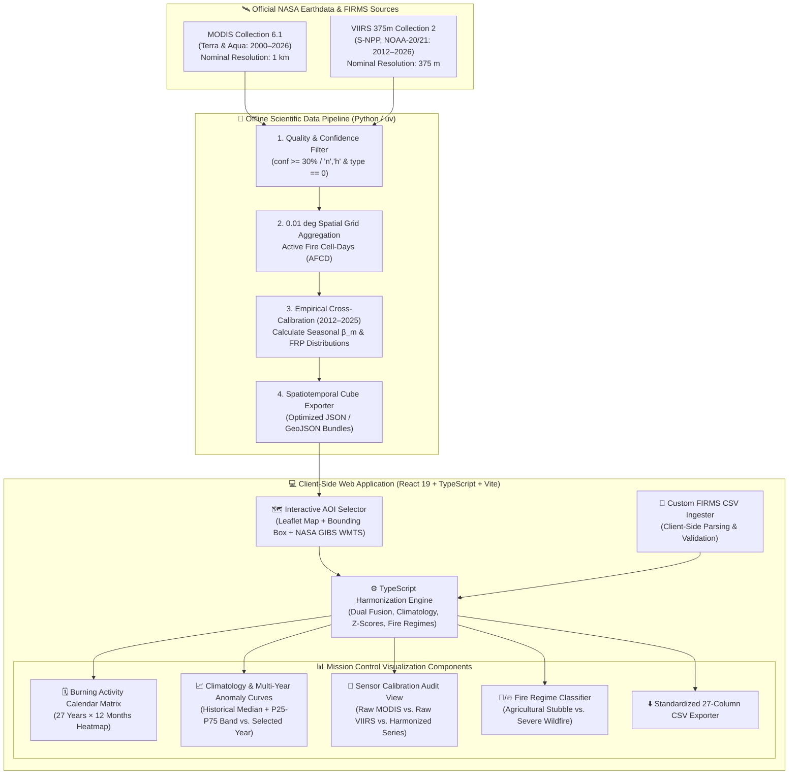

# 03 — System Technical Architecture & Data Engine: TerraSpot Harmonizer

* **Project Name:** TerraSpot Harmonizer
* **Official NASA Challenge:** Challenge 15 — *Harmonization of MODIS and VIIRS Hot Spots*
* **Role:** Geospatial Software & Systems Architecture
* **Document Version:** 1.0

---

## 1. Architectural Design Principles (NASA Hackathon-Ready)

To ensure that NASA Space Apps judges and operational wildfire analysts can evaluate the platform with zero latency, zero server outages, and zero authentication friction, the system is engineered around four core architectural pillars:

1. **Zero-Latency Edge Computing (Pre-Indexed Spatial Cubes + In-Browser Compute):**
   Executing geospatial queries across 26 years of global satellite detections on traditional server-side databases introduces multi-second network roundtrips. Our architecture pre-indexes thermal anomalies into compact, spatial JSON cubes and executes the pure TypeScript mathematical harmonization engine client-side in **under 30 milliseconds** when drawing or adjusting an Area of Interest (AOI).
2. **Dual-Ingestion Workflow (Curated Presets + User-Uploaded FIRMS CSVs):**
   * **Instant Exploration Mode:** Pre-packaged, validated 2000–2026 satellite time series for iconic benchmark regions (Huánuco/Peruvian Andes, Amazon Basin, California, Australia, Paraná River Delta, and global grids).
   * **Custom Laboratory Mode (*Custom FIRMS CSV Uploader & In-Browser Parser*):** Allows scientists and judges to drag-and-drop their own NASA FIRMS CSV export (MODIS or VIIRS) to harmonize and visualize it dynamically in-browser.
3. **Resilient Serverless Static Deployment:**
   The production artifact is a high-performance static Single Page Application (SPA) deployed across global edge networks (Vercel / GitHub Pages), ensuring 99.99% availability during evaluation peaks.
4. **Perceptually Uniform Scientific Accessibility (WCAG 2.1 AA):**
   Decoupled color ramp engine delivering mathematical mapping to colorblind-certified scales (*Inferno, Viridis, Cividis, and Diverging Blue-White-Red*).

---

## 2. High-Level System Architecture Diagram



---

## 3. Technology Stack & Technical Rationale

| Architectural Tier | Technology | Technical Rationale for NASA Challenge 15 |
| :--- | :--- | :--- |
| **Frontend Framework** | **React 19 + TypeScript 5.7+ + Vite 6** | Strict type safety for complex physical formulas, lightning-fast HMR, and ultra-small production bundles. |
| **Styling & Design Tokens** | **Tailwind CSS v4 + Lucide Icons** | Aerospace dark-theme aesthetic (`#0B0F17`, `#131B2E`) with high visual contrast and zero CSS bloat. |
| **Geospatial Cartography** | **Leaflet + React-Leaflet** | Lightweight footprint, zero proprietary map token barriers, native GeoJSON and bounding-box drawing capabilities. |
| **Satellite Imagery Layers** | **NASA GIBS (WMTS Tile Layer)** | Direct integration with NASA Earthdata Global Imagery Browse Services (Terra/Aqua True Color and VIIRS Day/Night). |
| **Scientific Data Visualization** | **Custom Scalable Matrix + Recharts** | High-density 27×12 heatmaps with SVG rendering and smooth animated time-series charts. |
| **Scientific Data Pipeline** | **Python 3.13 (`uv`, `pandas`, `numpy`)** | Efficient offline aggregation of multi-gigabyte FIRMS CSV archives into lightweight spatiotemporal cubes. |
| **Continuous Integration & Testing** | **Vitest + Husky (Git Hooks)** | Sub-second unit testing of mathematical harmonization routines and automated commit validation. |
| **Deployment & Hosting** | **Vercel / GitHub Pages** | Instant global CDN delivery with 100% public, HTTPS-secured availability and zero authentication requirements. |

---

## 4. Repository Directory Organization

```text
terraspot-harmonizer/
├── .agents/                               # Antigravity Spec Kit agent skills
├── .reference/                            # Internal reference guidelines (Ignored by Git)
├── docs/                                  # Project technical & engineering documentation
│   ├── 01-prd-terraspot-harmonizer.md
│   ├── 02-modis-viirs-harmonization-methodology.md
│   ├── 03-system-technical-architecture.md
│   ├── 04-firms-data-specification.md
│   ├── 05-submission-pitch-rubric-plan.md
│   ├── 06-technology-stack-tools.md
│   ├── backlog.md
│   ├── design-system.md
│   ├── operational-work-plan.md
│   └── workflow.md
├── scripts/                               # Data automation & scientific pipelines
│   ├── create_github_issues.py            # GitHub issues, milestones, and project board sync
│   └── build_harmonized_cubes.py          # FIRMS data pre-processor and JSON cube generator
├── public/
│   └── data/                              # Pre-computed data bundles and test fixtures
│       ├── regions_catalog.json           # Catalog of benchmark AOIs, bounds, and climatology
│       ├── firms_spatial_cells.json       # 0.01-degree spatial density grid for Leaflet overlay
│       └── sample_firms_huanuco.csv       # Test sample for custom CSV ingestion verification
├── src/                                   # Frontend web application source code
│   ├── components/
│   │   ├── Navbar.tsx                     # Top navigation, AOI switcher, color ramp selector, EN/ES toggle
│   │   ├── MapAOISelector.tsx             # Interactive Leaflet map + Bounding Box tool + NASA GIBS
│   │   ├── BurningCalendarMatrix.tsx      # 27×12 Burning Activity Calendar matrix
│   │   ├── ClimatologyAnomalyChart.tsx    # Climatological baseline vs. selected year anomaly curves
│   │   ├── SensorHarmonizationAudit.tsx   # MODIS vs. VIIRS cross-calibration comparison modal/tab
│   │   ├── FireRegimePanel.tsx            # Agricultural vs. wildfire classification panel (FRP & Night Ratio)
│   │   ├── KPISummaryCards.tsx            # Executive KPI summary cards
│   │   └── CustomCSVModal.tsx             # Drag-and-drop NASA FIRMS CSV ingestion modal
│   ├── engine/
│   │   ├── harmonizer.ts                  # Pure TypeScript TerraSpot 4-Stage mathematical engine
│   │   ├── colorRamps.ts                  # Colorblind-safe palettes (Inferno, Viridis, Cividis, Diverging)
│   │   └── csvExporter.ts                 # RFC 4180 standardized 27-column CSV generator
│   ├── types/
│   │   └── fireData.ts                    # TypeScript data contracts and schema definitions
│   ├── App.tsx                            # Root application layout
│   └── main.tsx
├── index.html
├── package.json
├── tsconfig.json
└── vite.config.ts
```

---

## 5. Core Data Contract Interfaces (`src/types/fireData.ts`)

```typescript
export type FireRegimeType = 'AGRICULTURAL_SEASONAL' | 'MIXED_TRANSITIONAL' | 'SEVERE_WILDFIRE';

export type ColorRampType = 'INFERNO' | 'VIRIDIS' | 'CIVIDIS' | 'DIVERGING_ANOMALY';

export interface MonthlyFireRecord {
  year: number;                  // 2000 - 2026
  month: number;                 // 1 (Jan) - 12 (Dec)
  rawModisCount: number;         // Raw MODIS detection count
  rawViirsCount: number;         // Raw VIIRS 375m detection count
  modisCellDays: number;         // Active Fire Cell-Days on 0.01 deg grid (MODIS)
  viirsCellDays: number;         // Active Fire Cell-Days on 0.01 deg grid (VIIRS)
  betaFactor: number;            // Monthly seasonal cross-calibration scaling factor β_m
  harmonizedHotspots: number;    // Final harmonized metric H_(y,m)
  historicalMedian: number;      // Climatological median baseline for month m (2001-2025)
  percentile25: number;          // Historical 25th percentile (P25)
  percentile75: number;          // Historical 75th percentile (P75)
  percentile90: number;          // Critical alert threshold (P90)
  anomalyPct: number;            // Percentage deviation from historical median
  robustZScore: number;          // Robust Z-score normalized by IQR
  meanFrpMw: number;             // Mean Fire Radiative Power (MW)
  p90FrpMw: number;              // 90th percentile of FRP (MW)
  nightFraction: number;         // Ratio of nighttime detections (0.0 to 1.0)
  regimeScore: number;           // Fire Regime Intensity Index (0 to 100)
  regimeClass: FireRegimeType;   // Diagnostic fire regime classification
}

export interface BoundingBoxAOI {
  id: string;
  name: string;
  country: string;
  description: string;
  minLat: number;
  maxLat: number;
  minLon: number;
  maxLon: number;
  center: [number, number];
  zoom: number;
}

export interface RegionDataBundle {
  aoi: BoundingBoxAOI;
  monthlyRecords: MonthlyFireRecord[];
  seasonalBetaFactors: number[]; // 12 elements (Jan - Dec)
  modelFitMetrics: {
    r2: number;
    rmse: number;
    mapeReductionPct: number;
  };
}
```

---

## 6. Mission Control User Interface Architecture

The layout is arranged into a high-density, **single-viewport mission control workspace**, eliminating convoluted page transitions:

1. **Top Navigation Bar:** TerraSpot brand insignia, NASA Challenge 15 indicator, AOI preset dropdown, color ramp selector, bilingual `EN / ES` switcher, *"Upload Custom FIRMS CSV"* button, and highlighted **"Download Harmonized CSV"** action.
2. **Executive KPI Header:**
   * *Harmonized Active Fire Cell-Days* (Total and annual average).
   * *Peak Fire Window* (Historically identified peak months).
   * *Active Period Anomaly* ($\Delta\%$ and $Z$-score with color-coded severity tags).
   * *Dominant Fire Regime* (Interactive badge: Agricultural vs. Severe Wildfire).
3. **Left Viewport (40% width) — Interactive Cartography (`MapAOISelector`):**
   * Leaflet cartographic canvas featuring dark aerospace basemaps, optional NASA GIBS True Color satellite tiles, bounding-box selection tools, and $0.01^\circ$ active cell density heat-layers.
4. **Primary Center/Right Viewport (60% width) — Burning Activity Calendar Matrix:**
   * Interactive heatmap of **27 rows (2000–2026) × 12 columns (Jan–Dec)**.
   * View Metric Selector:
     1. *Harmonized Hotspot Frequency* ($H_{y,m}$).
     2. *Historical Anomaly ($\Delta\%$ vs. Climatological Median)* (Diverging Blue-White-Red scale).
     3. *Fire Radiative Power (FRP Intensity in MW)*.
   * Universal colorblind-safe palette toggles (*Inferno*, *Viridis*, *Cividis*, *Anomaly Diverging*).
5. **Lower Analytical Workspace — Synchronized Scientific Tabs:**
   * **Tab 1: Climatological Trend & Anomaly Series:** Time-series curve comparing selected year against the multi-year median and P25–P75 IQR envelope.
   * **Tab 2: Sensor Harmonization Audit (MODIS vs. VIIRS):** Full 2000–2026 time-series displaying the raw 2012 step-jump and demonstrating mathematical convergence ($R^2 > 0.90$) under the *TerraSpot* algorithm.
   * **Tab 3: Fire Regime Diagnostics:** Scatter plot mapping Night Combustion Fraction ($f_{\text{night}}$) against Radiative Power ($\text{FRP}$), clearly demarcating low-intensity agricultural burns from catastrophic wildfires.
