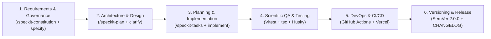
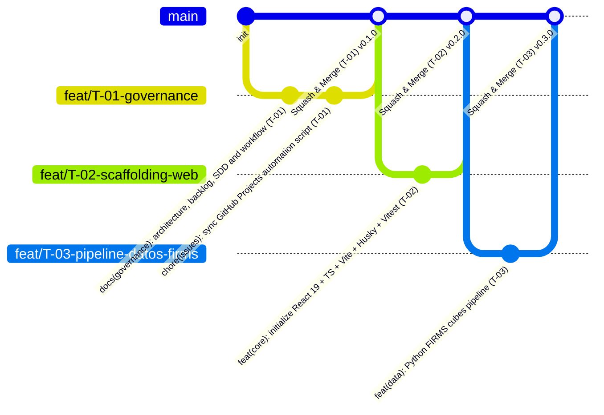

# 🔄 Development Workflow, SDLC, SDD (Spec Kit) & Engineering Governance — TerraSpot Harmonizer

This document establishes the operational framework of the **Software Development Life Cycle (SDLC)** governed by **Spec-Driven Development (SDD via Spec Kit)**, together with Git Flow conventions, **Husky**, **Vitest**, **GitHub Actions CI/CD**, and **SemVer 2.0.0** for the **TerraSpot Harmonizer** project led by **Wilmer Gulcochía Sánchez (@wigsdev)** for the **NASA Space Apps Challenge 2026**.

---

## 1. SDLC Integration with Spec-Driven Development (SDD)

In **TerraSpot Harmonizer**, each classic phase of the **Software Development Life Cycle (SDLC)** is governed and validated by **Spec Kit (`specify-cli`)** artifacts and skills:



| SDLC Phase | Spec Kit SDD Flow | Living Repository Artifacts | Verification Tooling |
| :--- | :--- | :--- | :--- |
| **1. Governance & Requirements** | `/speckit-constitution`<br>`/speckit-specify` & `/speckit-clarify` | `AGENTS.md`, `.specify/memory/constitution.md`, `docs/01-prd-terraspot-harmonizer.md`, `specs/*/spec.md` | NASA Challenge 15 Acceptance Criteria Review |
| **2. Scientific & Software Design** | `/speckit-plan` & `/speckit-checklist` | `docs/02-modis-viirs-harmonization-methodology.md`, `docs/03-system-technical-architecture.md`, `docs/design-system.md`, `specs/*/plan.md` | Physical/Mathematical MODIS/VIIRS Validation & WCAG AA Audit |
| **3. Task Breakdown & Code** | `/speckit-tasks`<br>`/speckit-analyze` & `/speckit-implement` | `docs/backlog.md` (`T-01` to `T-12`), `docs/operational-work-plan.md`, `specs/*/tasks.md`, `src/`, `scripts/` | `pnpm dev`, `python3 scripts/build_harmonized_cubes.py` |
| **4. Scientific Testing & QA** | Continuous DoD Verification | `tests/harmonizer.test.ts`, `tests/colorRamps.test.ts`, `vitest.config.ts` | **Vitest** (`pnpm test:run`), TypeScript (`pnpm build`), **Husky** (`pre-commit`) |
| **5. Integration & Edge CI/CD** | Automated Cloud Pipeline | `.github/workflows/ci.yml`, `dist/` | **GitHub Actions CI** + **Vercel / GitHub Pages (HTTPS)** |
| **6. Versioning & Traceability** | SemVer Closure Protocol | `package.json`, `CHANGELOG.md` (`v0.1.0` $\rightarrow$ `v1.0.0`) | **Husky** (`commit-msg`) + Explicit Developer Approval |

---

## 2. Branching Strategy (Individual GitHub Flow)

To ensure enterprise-grade git history, complete scientific traceability, and transparency for NASA global evaluators:



### 2.1 Branching Rules
* **Production Branch (`main`):**
  * Always deployable, clean build, 100% tests passing, zero warnings.
  * Direct commits without validation are strictly prohibited.
* **Feature Branches (`feat/T-XX-task-name`):**
  * Created for each atomic backlog task ([docs/backlog.md](backlog.md)).
  * Naming standard: `feat/T-01-governance`, `feat/T-02-scaffolding-web`, `feat/T-03-pipeline-datos-firms`, etc.
* **Bugfix Branches (`fix/T-XX-bug-name`):**
  * For targeted hotfixes or mathematical adjustments detected during QA.
* **Consolidation & Merge:**
  * Clean integration into `main` referencing the corresponding GitHub Issue (`Closes #XX`).

---

## 3. Commit Convention (Conventional Commits v1.0.0 + Husky)

Every commit must be atomic, descriptive, and is validated by the **`.husky/commit-msg`** hook:

```text
<type>(<scope>): <short imperative description> (T-XX)
```

### 3.1 Allowed Commit Types
| Type | Semantic Meaning | Example |
|---|---|---|
| `feat` | New feature, mathematical module, or component | `feat(engine): implement TerraSpot 4-Stage algorithm in TS (T-04)` |
| `fix` | Bug fix or mathematical calibration adjustment | `fix(calendar): correct diverging scale for zero-fire wet months (T-07)` |
| `test` | Adding or updating unit tests with Vitest | `test(engine): add test suite for beta factors and robust Z-score (T-04)` |
| `style` | CSS design tokens, layout styling, accessible ramps | `style(theme): configure aerospace dark mode tokens and ramps (T-05)` |
| `docs` | Scientific documentation, SDD specifications, slides | `docs(governance): draft backlog, work plan and AGENTS.md (T-01)` |
| `chore` | Scaffolding, dependencies, Husky, CI/CD, scripts | `chore(ci): configure GitHub Actions workflow and Husky hooks (T-02)` |
| `refactor` | Internal code cleanup without altering external behavior | `refactor(map): optimize spatial cell filtering by AOI bounds (T-06)` |

---

## 4. Automated Quality Assurance: Vitest, Husky & GitHub Actions CI/CD

### 4.1 Scientific Unit Testing with Vitest (`tests/`)
The mathematical harmonization engine (`src/engine/harmonizer.ts`) and the accessible palette engine (`src/engine/colorRamps.ts`) are validated via **Vitest** (`pnpm test:run`):
* Verification of $0.01^\circ$ spatial grid aggregation (*Active Fire Cell-Days*).
* Convergence of MODIS and VIIRS series ($R^2 > 0.90$) via seasonal $\beta_m$ factors.
* Accurate non-parametric climatology (historical median, IQR, P90 alert threshold, and robust $Z$-score).
* Diagnostic fire regime classification (*Seasonal Agricultural Burning* vs. *Severe Landscape Wildfire*).

### 4.2 Local Pre-Commit Gatekeepers via Husky (`.husky/`)
* **`.husky/pre-commit`:** Automatically executes:
  1. `.reference/` isolation check (prevents internal reference files from being committed).
  2. TypeScript strict compilation check (`pnpm build`).
  3. Automated unit test suite execution (`pnpm test:run`).
* **`.husky/commit-msg`:** Validates commit message adherence to `<type>(<scope>): <description> (T-XX)`.

### 4.3 Continuous Integration via GitHub Actions (`.github/workflows/ci.yml`)
Every push or Pull Request triggers cloud CI validation:
1. Clean dependency installation with `pnpm` on Node.js `v24`.
2. Python `3.13` data pipeline verification (`python3 scripts/build_harmonized_cubes.py`).
3. Strict TypeScript typechecking.
4. Comprehensive **Vitest** test suite execution.
5. Production static bundle compilation (`pnpm build`).

---

## 5. Semantic Versioning (SemVer 2.0.0) & Closure Protocol

The project adheres to [SemVer 2.0.0](https://semver.org/) starting at `0.1.0` (`T-01`) and concluding at `1.0.0` (`T-12`):

```text
MAJOR.MINOR.PATCH
```

### 5.1 Version Bump Rules per Task
* **MINOR (`0.X.0`):** Incremented whenever a task introduces a **new structural milestone, data pipeline, mathematical engine, or UI view** (`T-01` $\rightarrow$ `0.1.0`, `T-02` $\rightarrow$ `0.2.0`, ..., `T-11` $\rightarrow$ `0.11.0`).
* **PATCH (`0.X.Y`):** Incremented for **bug fixes, style adjustments, or incremental refactors**.
* **MAJOR (`1.0.0`):** Reached at `T-12` upon final public deployment, 7-slide presentation delivery, and NASA Space Apps submission form completion.

### 5.2 Mandatory Task Closure Protocol
To maintain strict engineering rigor:
1. **Verification & DoD Check:** Run `pnpm build` and `pnpm test:run`, confirming zero errors and zero warnings.
2. **Version Bump:** Update `"version"` in `package.json`.
3. **Changelog Record:** Document all additions, modifications, or fixes in [**`CHANGELOG.md`**](../CHANGELOG.md) under the *Keep a Changelog* format (`Added`, `Changed`, `Fixed`).
4. **Summary Presentation & Pause:** Present the modified file summary, test outcomes, and proposed commit message in chat, remaining in standby.
5. **Strict Commit Authorization:** Execute `git commit` **ONLY after receiving explicit approval ("visto bueno")** from Wilmer (`@wigsdev`).

---

## 6. Definition of Done (DoD)

A task is officially marked as **Done** (`COMPLETED`) only when:
- [ ] Code is formatted and compiles cleanly (`pnpm build` with zero TypeScript errors).
- [ ] Unit tests pass with 100% green status (`pnpm test:run`).
- [ ] No files from `.reference/` are included in the git staging index.
- [ ] `CHANGELOG.md` and `package.json` are synchronized to the appropriate SemVer tag.
- [ ] The developer has reviewed and provided explicit approval for the commit.
