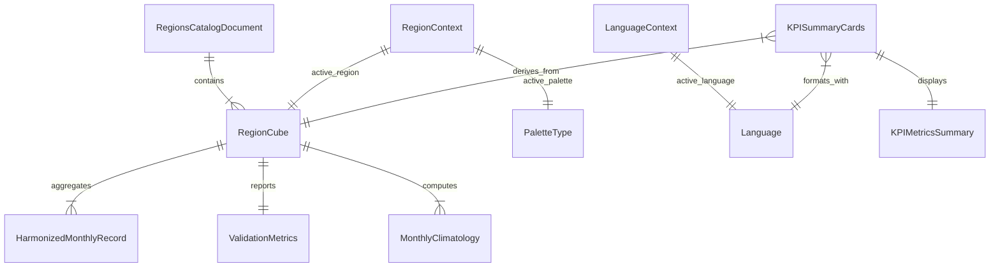

# Phase 1: Data Model & Entity Specifications

**Feature**: Mission Navigation Shell & Dynamic KPI Summary Panel (`004-navigation-kpis-shell`)  
**Branch**: `feat/T-05-shell-navegacion-kpis`  
**Date**: 2026-11-14  

---

## 1. Entity Relationship Diagram



---

## 2. Entities & Interfaces

### 2.1 Language & Bilingual Dictionary Entities

```typescript
export type Language = 'en' | 'es';

export interface BilingualDictionary {
  navbar: {
    title: string;
    subtitle: string;
    challengeBadge: string;
    sensorBaseline: string;
    regionSelectLabel: string;
    paletteSelectLabel: string;
    languageToggleLabel: string;
    exportCsvButton: string;
  };
  regions: Record<string, {
    name: string;
    country: string;
    regimeName: string;
  }>;
  palettes: {
    inferno: string;
    viridis: string;
    cividis: string;
    diverging: string;
  };
  kpiCards: {
    card1Title: string;
    card1MetricUnit: string;
    card1Subtext: (r2: number) => string;
    card2Title: string;
    card2Subtext: (sharePct: number) => string;
    card3Title: string;
    card3Subtitle: string;
    card3Subtext: (deltaPct: number, zScore: number) => string;
    card4Title: string;
    card4FrpLabel: string;
    card4NightLabel: string;
    alertStatus: {
      NORMAL: string;
      ELEVATED: string;
      CRITICAL: string;
    };
    regimeClasses: {
      AGRICULTURAL_BURN: string;
      TRANSITIONAL: string;
      SEVERE_WILDFIRE: string;
    };
  };
  months: {
    short: string[]; // [Jan, Feb, ...] or [Ene, Feb, ...]
    long: string[];
  };
}
```

### 2.2 Region Context State Entity

```typescript
export interface RegionContextState {
  currentRegionId: string;
  currentRegion: RegionCube | null;
  regionsList: BenchmarkRegionSummary[];
  activePalette: PaletteType;
  isLoading: boolean;
  error: string | null;
  setRegionId: (id: string) => void;
  setPalette: (palette: PaletteType) => void;
}

export interface BenchmarkRegionSummary {
  id: string;
  name: string;
  country: string;
  typical_fire_regime: string;
}
```

### 2.3 Calculated KPI Summary View Model (`KPIMetricsSummary`)

```typescript
export interface KPIMetricsSummary {
  // Card 1: Total Harmonized Fire Activity
  totalAfcd: number; // Cumulative sum of harmonized_hotspots across all 322 months
  formattedTotalAfcd: string; // e.g. "38,420" (en) or "38.420" (es)
  validationR2: number; // e.g. 0.941
  formattedR2: string; // "R² = 0.94"

  // Card 2: Peak Burning Season
  peakSeasonMonths: number[]; // e.g. [8, 9, 10]
  peakSeasonLabel: string; // "Aug – Oct" or "Ago – Oct"
  peakSeasonSharePct: number; // e.g. 68.4
  formattedPeakShare: string; // "68.4%"

  // Card 3: Season Anomaly Alert (2026-10 vs M_10)
  latestObservationDate: string; // "2026-10"
  latestDeparturePct: number; // Delta% vs October historical median
  formattedDeparturePct: string; // e.g. "+42.8%" or "-15.2%"
  robustZScore: number; // e.g. +2.14
  formattedZScore: string; // "Z = +2.14"
  alertTier: 'NORMAL' | 'ELEVATED' | 'CRITICAL';
  alertBadgeLabel: string; // "CRITICAL ALERT" or "ALERTA CRÍTICA"

  // Card 4: Dominant Fire Regime Diagnostic
  dominantRegimeClass: 'AGRICULTURAL_BURN' | 'TRANSITIONAL' | 'SEVERE_WILDFIRE';
  regimeBadgeLabel: string; // "Severe Wildfire" / "Incendio Forestal Severo"
  meanFrpMw: number; // e.g. 48.6
  formattedMeanFrp: string; // "48.6 MW"
  nightFireFractionPct: number; // e.g. 24.5
  formattedNightFraction: string; // "24.5%"
}
```

---

## 3. Data Transformations & Validation Rules

1. **Cumulative AFCD Calculation**:
   $$\text{Total AFCD} = \sum_{t=1}^{N} H_{y,m}^{(t)}$$
   Strictly integer or rounded float representation, formatted according to active locale (`en-US` vs `es-PE`).

2. **Peak Season Concentration Share**:
   $$\text{Share}_{\text{peak}} = \frac{\sum_{m \in \text{Peak}} \bar{H}_m}{\sum_{m=1}^{12} \bar{H}_m} \times 100\%$$

3. **Active Anomaly Alert Rule (Clarification Decided)**:
   - Target month: $t_{\text{latest}} = \text{records}[\text{length} - 1]$ (i.e. `2026-10`).
   - $\Delta\% = \text{departure\_percentage}$.
   - $Z = \text{robust\_z\_score}$.
   - Thresholds:
     - $Z < 1.0 \implies \text{NORMAL}$ (Green, `status-success`).
     - $1.0 \le Z < 2.0 \implies \text{ELEVATED}$ (Amber, `status-warning`).
     - $Z \ge 2.0 \implies \text{CRITICAL}$ (Red, `status-danger`).

4. **Regime Diagnostic Rule**:
   - $\text{Regime} = \text{cube.typical\_fire\_regime}$ or latest record `regime_class`.
   - $\text{Mean FRP} = \frac{1}{N}\sum \text{mean\_frp\_mw}$.
   - $\text{Night Fraction} = \frac{1}{N}\sum \text{night\_fraction} \times 100\%$.
