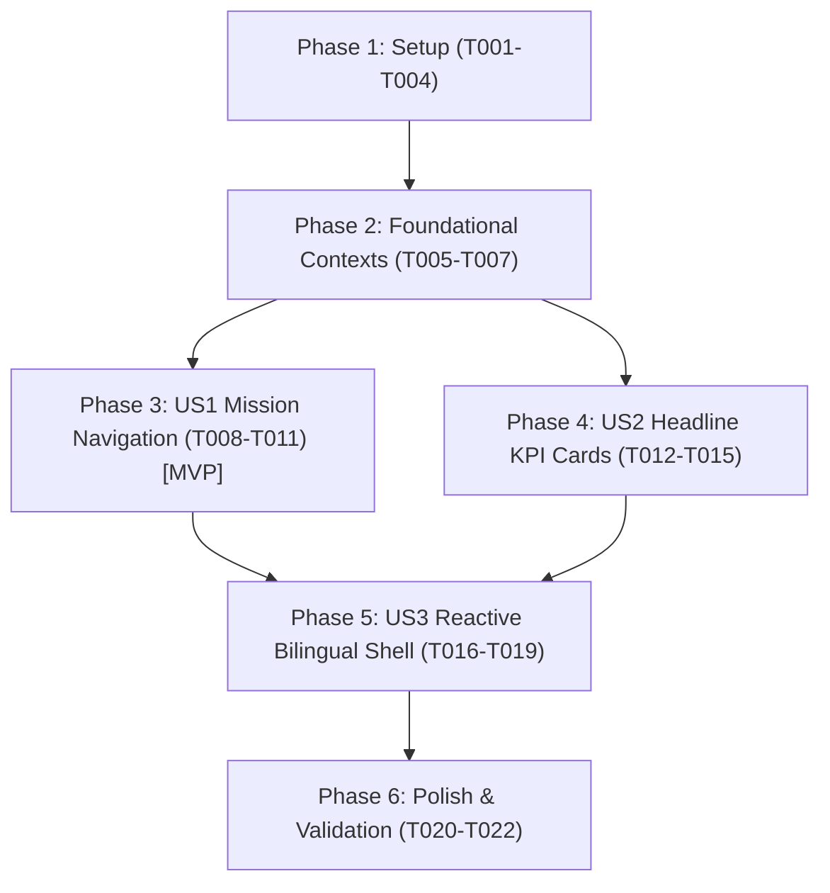

# Tasks: Mission Navigation Shell & Dynamic KPI Summary Panel

**Input**: Design documents from `specs/004-navigation-kpis-shell/` (`spec.md`, `plan.md`, `data-model.md`, `contracts/`, `research.md`, `quickstart.md`)  
**Prerequisites**: `spec.md`, `plan.md`, `data-model.md`, `contracts/`  
**Tests**: Automated component tests requested in `FR-008` and `SC-004` (Vitest + Testing Library)  
**Organization**: Tasks are grouped by user story to enable independent implementation and testing of each story.

---

## Format: `[ID] [P?] [Story] Description`

- **[P]**: Can run in parallel (different files, no dependencies)
- **[Story]**: Which user story this task belongs to (`[US1]`, `[US2]`, `[US3]`)
- Include exact file paths in descriptions

---

## Phase 1: Setup (Shared Infrastructure)

**Purpose**: Shared types, localization contracts, and pure calculation infrastructure

- [X] T001 [P] Create language and bilingual dictionary types in `src/types/language.ts` following `contracts/language-context.contract.ts`
- [X] T002 [P] Export new language types in `src/types/index.ts`
- [X] T003 Implement pure mathematical KPI calculation engine in `src/engine/kpiCalculator.ts` following `contracts/kpi-summary.contract.ts` and `data-model.md`
- [X] T004 Export `kpiCalculator` functions in `src/engine/index.ts`

---

## Phase 2: Foundational (Blocking Prerequisites)

**Purpose**: Core React Context providers required before components can be mounted and tested

**⚠️ CRITICAL**: No user story UI implementation can begin until this phase is complete

- [X] T005 Implement `LanguageContext.tsx` with English (default) and Spanish dictionaries in `src/context/LanguageContext.tsx`
- [X] T006 Implement `RegionContext.tsx` managing active region cube, benchmark catalog loading, and palette selection in `src/context/RegionContext.tsx`
- [X] T007 Export context providers and custom hooks (`useLanguage`, `useRegion`) in `src/context/index.ts`

**Checkpoint**: Core foundation ready — reactive bilingual state and global region cube state available across all components.

---

## Phase 3: User Story 1 - Mission Navigation & Dynamic Benchmark Region Selection (Priority: P1) 🎯 MVP

**Goal**: Deliver the primary top mission navigation bar (`Navbar.tsx`) with brand logo, Challenge 15 indicator, version tag, sensor baseline pill, region dropdown selector (5 benchmark AOIs), and accessible palette selector.

**Independent Test**: Mount `Navbar.tsx` inside `RegionProvider` and `LanguageProvider`, interact with the region dropdown to select each of the 5 benchmark regions, interact with the palette dropdown to select all 4 ramps, and verify that selection events update global state without errors.

### Tests for User Story 1 ⚠️

- [X] T008 [P] [US1] Create automated component unit tests for navigation shell, dropdowns, and badges in `tests/Navbar.test.tsx`

### Implementation for User Story 1

- [X] T009 [US1] Implement primary mission navigation component in `src/components/Navbar.tsx` with brand mark, Challenge 15 badge, version pill, sensor baseline indicator, and accessible dropdown selectors
- [X] T010 [US1] Integrate `Navbar.tsx` into `src/App.tsx` wrapped in `LanguageProvider` and `RegionProvider`
- [X] T011 [US1] Verify Vitest passes for User Story 1 via `pnpm test:run tests/Navbar.test.tsx`

**Checkpoint**: At this point, User Story 1 (MVP) is fully functional and testable independently.

---

## Phase 4: User Story 2 - Real-Time Headline Mission KPI Summary Cards (Priority: P2)

**Goal**: Deliver the 4 responsive headline KPI summary cards (`KPISummaryCards.tsx`) displaying cumulative AFCD ($2000\text{--}2026$) with $R^2$, peak burning season with % annual load, operational climatological anomaly alert (`2026-10` vs $M_{10}$), and fire regime classification.

**Independent Test**: Mount `KPISummaryCards.tsx` with benchmark regions (`PE-HCO`, `US-CAL`, `SAM-MAP`), verifying that all 4 cards render mathematically accurate figures, localized formatting, and color-coded severity badges (`NORMAL`, `ELEVATED`, `CRITICAL`).

### Tests for User Story 2 ⚠️

- [X] T012 [P] [US2] Create automated component unit tests for the 4 KPI summary cards across multiple benchmark regions in `tests/KPISummaryCards.test.tsx`

### Implementation for User Story 2

- [X] T013 [US2] Implement the 4-card responsive executive panel in `src/components/KPISummaryCards.tsx` adapting to 1 col (mobile), 2 cols (tablet), and 4 cols (desktop) with skeleton loading placeholders
- [X] T014 [US2] Mount `KPISummaryCards.tsx` in `src/App.tsx` replacing previous static placeholder cards
- [X] T015 [US2] Verify Vitest passes for User Story 2 via `pnpm test:run tests/KPISummaryCards.test.tsx`

**Checkpoint**: User Stories 1 AND 2 are both functional and synchronized with live region data.

---

## Phase 5: User Story 3 - Reactive Bilingual Context & Global Accessibility (Priority: P3)

**Goal**: Enable instantaneous toggling between English (`EN`) and Spanish (`ES`) across the entire navigation shell and KPI panel, maintaining WCAG 2.1 Level AA high-contrast visual accessibility.

**Independent Test**: Toggle between `EN` and `ES` via the language button in `Navbar.tsx` and verify that all labels, dropdown options, and KPI texts translate dynamically without losing the active region or palette selection.

### Tests for User Story 3 ⚠️

- [X] T016 [P] [US3] Add bilingual switching tests and locale formatting verification in `tests/Navbar.test.tsx` and `tests/KPISummaryCards.test.tsx`

### Implementation for User Story 3

- [X] T017 [US3] Add language toggle button (`EN` / `ES`) and reactive dictionary wiring in `src/components/Navbar.tsx`
- [X] T018 [US3] Add bilingual text translations and `Intl.NumberFormat` localized separators in `src/components/KPISummaryCards.tsx`
- [X] T019 [US3] Update root integration tests in `tests/App.test.tsx` to verify bilingual state propagation and accessibility markers

**Checkpoint**: All three user stories are complete, bilingually synchronized, and independently testable.

---

## Phase 6: Polish & Cross-Cutting Concerns

**Purpose**: End-to-end verification, type checking, bundle verification, and milestone documentation

- [X] T020 Run complete automated test suite via `pnpm test:run` ensuring 100% test passing rate across all test files
- [X] T021 Run strict TypeScript verification via `pnpm typecheck` and production build via `pnpm build`
- [X] T022 [P] Update version to `0.5.0` in `package.json` and document all additions, modifications, and fixes in `CHANGELOG.md` adhering to Keep a Changelog format

---

## Dependencies & Execution Order

### Phase Dependencies
- **Setup (Phase 1)**: No dependencies — executes immediately.
- **Foundational (Phase 2)**: Depends on Phase 1 completion — blocks all user stories.
- **US1 Navigation (Phase 3)**: Depends on Phase 2 completion — delivers MVP.
- **US2 KPI Cards (Phase 4)**: Depends on Phase 2 completion — can be developed in parallel with US1.
- **US3 Bilingual Context (Phase 5)**: Integrates reactive language toggling across US1 and US2 components.
- **Polish (Phase 6)**: Runs full suite verification and SemVer documentation.

### Parallel Opportunities
- `T001` (`types/language.ts`) and `T002` (`types/index.ts`) can run in parallel with `T003` (`engine/kpiCalculator.ts`).
- `T008` (`Navbar.test.tsx`) can be authored while `T012` (`KPISummaryCards.test.tsx`) is authored.
- `T009` (`Navbar.tsx`) and `T013` (`KPISummaryCards.tsx`) work on separate files without merge conflicts.

---

## Implementation Strategy

### MVP First (User Story 1 Only)
1. Complete Phase 1 (Setup) + Phase 2 (Foundational Contexts).
2. Complete Phase 3 (User Story 1: `Navbar.tsx`).
3. Validate: User Story 1 provides persistent brand shell and benchmark region selection.

### Incremental Delivery
1. Add User Story 2 (`KPISummaryCards.tsx`): Real-time executive metrics display.
2. Add User Story 3 (Bilingual Switching): Full English/Spanish parity for NASA judging.
3. Polish & Validate: Clean build, all tests green, SemVer increment to `0.5.0`.
