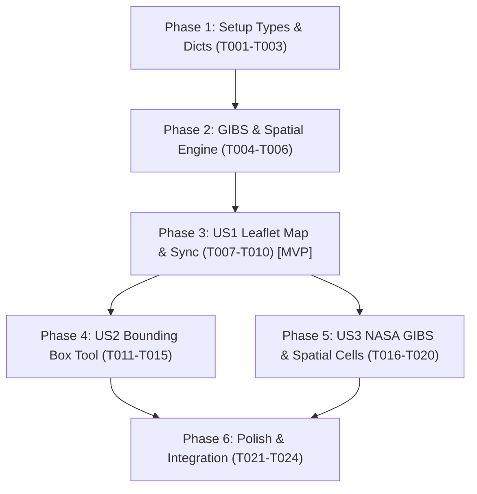

# Tasks: Interactive Cartographic WebGIS Canvas with Bounding Box & NASA GIBS WMTS

**Input**: Design documents from `specs/005-map-aoi-gibs/` (`spec.md`, `plan.md`, `data-model.md`, `contracts/`, `research.md`, `quickstart.md`)  
**Prerequisites**: `spec.md`, `plan.md`, `data-model.md`, `contracts/`  
**Tests**: Automated component tests requested in `FR-008` and `SC-005` (Vitest + Testing Library)  
**Organization**: Tasks are grouped by user story to enable independent implementation and testing of each story.

---

## Format: `[ID] [P?] [Story] Description`

- **[P]**: Can run in parallel (different files, no dependencies)
- **[Story]**: Which user story this task belongs to (`[US1]`, `[US2]`, `[US3]`)
- Include exact file paths in descriptions

---

## Phase 1: Setup (Shared Infrastructure)

**Purpose**: Shared types, NASA GIBS layer contracts, and bilingual dictionary extensions

- [X] T001 [P] Create Map, NASA GIBS, and layer types in `src/types/map.ts` following `specs/005-map-aoi-gibs/contracts/gibs-wmts.contract.ts` and `data-model.md`
- [X] T002 [P] Export new map types and benchmark GIBS reference dates in `src/types/index.ts`
- [X] T003 [P] Extend bilingual dictionary with map controls, layer names, and popup strings in `src/types/language.ts` and `src/context/LanguageContext.tsx`

---

## Phase 2: Foundational (Blocking Prerequisites)

**Purpose**: Core NASA GIBS URL formatting and spatial cell utilities required before UI components mount

**⚠️ CRITICAL**: No user story UI implementation can begin until this phase is complete

- [X] T004 [P] Implement NASA GIBS WMTS URL builder and layer definitions in `src/engine/gibsLayers.ts` following `contracts/gibs-wmts.contract.ts`
- [X] T005 [P] Implement spatial cells filtering and styling utility in `src/engine/spatialGrid.ts` following `contracts/spatial-cells.contract.ts`
- [X] T006 Export new engine utilities in `src/engine/index.ts`

**Checkpoint**: Core foundation ready — NASA GIBS URL resolvers and spatial cell filtering available across components.

---

## Phase 3: User Story 1 - Interactive Cartographic Canvas & Benchmark Region Synchronization (Priority: P1) 🎯 MVP

**Goal**: Deliver the primary interactive Leaflet map canvas (`MapAOISelector.tsx`) centered on the active benchmark region, with dark basemap and smooth `flyToBounds` camera transitions.

**Independent Test**: Mount `MapAOISelector.tsx` inside `RegionProvider` and `LanguageProvider`, switch between the 5 benchmark regions, and verify that the map smoothly navigates and refits its bounds to the selected region coordinates.

### Tests for User Story 1 ⚠️

- [X] T007 [P] [US1] Create automated unit tests for map mounting, basemap rendering, and benchmark region center/bounds synchronization in `tests/MapAOISelector.test.tsx`

### Implementation for User Story 1

- [X] T008 [US1] Implement core `MapAOISelector.tsx` cartographic shell with Leaflet `MapContainer`, dark basemap tile layer, and automatic `flyToBounds` region synchronization in `src/components/MapAOISelector.tsx`
- [X] T009 [US1] Add region quick-select pills and navigation zoom controls to the map overlay toolbar in `src/components/MapAOISelector.tsx`
- [X] T010 [US1] Verify User Story 1 tests pass via `pnpm test:run tests/MapAOISelector.test.tsx`

**Checkpoint**: At this point, User Story 1 (MVP) is fully functional and testable independently.

---

## Phase 4: User Story 2 - Interactive Bounding Box Drawing & Coordinate Inputs (Priority: P2)

**Goal**: Deliver the interactive rectangular bounding-box drawing tool and 4 synchronized numeric coordinate inputs (`min_lat`, `max_lat`, `min_lon`, `max_lon`) with instant reset and client-side subset re-harmonization callback.

**Independent Test**: Activate the "Draw AOI" tool, drag a rectangle across the map canvas, verify that coordinate fields update with normalized values, and click "Reset to Benchmark AOI" to restore default bounds.

### Tests for User Story 2 ⚠️

- [X] T011 [P] [US2] Add unit tests for bounding box drawing, coordinate input synchronization, validation, and reset in `tests/MapAOISelector.test.tsx`

### Implementation for User Story 2

- [X] T012 [US2] Implement native Leaflet drawing handler `BoundingBoxDrawHandler` with click-and-drag rectangle preview in `src/components/MapAOISelector.tsx`
- [X] T013 [US2] Implement 4 synchronized numeric coordinate inputs (`min_lat`, `max_lat`, `min_lon`, `max_lon`) with bidirectional validation and "Reset to Benchmark AOI" action in `src/components/MapAOISelector.tsx`
- [X] T014 [US2] Wire client-side spatial subset re-harmonization callback (`reharmonizeSpatialSubset`) triggered on bounding box completion in `src/components/MapAOISelector.tsx`
- [X] T015 [US2] Verify User Story 2 tests pass via `pnpm test:run tests/MapAOISelector.test.tsx`

**Checkpoint**: User Stories 1 AND 2 are both functional, synchronized with regional state, and testable independently.

---

## Phase 5: User Story 3 - NASA GIBS Satellite Imagery Overlays & Fire Cell Density Clusters (Priority: P3)

**Goal**: Deliver the NASA GIBS WMTS satellite tile layer switcher (MODIS Terra & VIIRS SNPP True Color) and render $0.01^\circ$ active fire cell density clusters with FRP color coding and informative popups.

**Independent Test**: Toggle on the NASA GIBS satellite layer, inspect tile loading, and click on an active fire cell to verify the dark aerospace popup with total AFCD, peak month, mean FRP, and night fraction.

### Tests for User Story 3 ⚠️

- [X] T016 [P] [US3] Add unit tests for NASA GIBS WMTS layer toggling and spatial cell cluster rendering in `tests/MapAOISelector.test.tsx`

### Implementation for User Story 3

- [X] T017 [US3] Implement map layer switcher dropdown/panel supporting CartoDB Dark Matter, NASA GIBS MODIS True Color, and VIIRS True Color in `src/components/MapAOISelector.tsx`
- [X] T018 [US3] Implement dynamic loading and rendering of $0.01^\circ$ active fire cell clusters from `public/data/firms_spatial_cells.json` styled by FRP and active palette in `src/components/MapAOISelector.tsx`
- [X] T019 [US3] Implement interactive dark aerospace popups for fire cells displaying coordinates, cumulative AFCD, peak month, mean FRP, and night fraction in `src/components/MapAOISelector.tsx`
- [X] T020 [US3] Verify User Story 3 tests pass via `pnpm test:run tests/MapAOISelector.test.tsx`

**Checkpoint**: All three user stories are complete, bilingually synchronized, and independently testable.

---

## Phase 6: Polish & Cross-Cutting Concerns

**Purpose**: End-to-end integration, strict typecheck, production build, and milestone documentation

- [X] T021 Mount `MapAOISelector.tsx` into `src/App.tsx` below `KPISummaryCards` replacing the operational readiness placeholder
- [X] T022 Update root integration tests in `tests/App.test.tsx` verifying map rendering and region/language reactivity
- [X] T023 Run full automated validation suite via `pnpm typecheck`, `pnpm test:run`, and `pnpm build`
- [X] T024 [P] Update version to `0.6.0` in `package.json` and document all additions, modifications, and fixes in `CHANGELOG.md` following Keep a Changelog

---

## Dependencies & Execution Order

### Phase Dependencies
- **Setup (Phase 1)**: No dependencies — executes immediately.
- **Foundational (Phase 2)**: Depends on Phase 1 completion — blocks all user stories.
- **US1 Map Canvas (Phase 3)**: Depends on Phase 2 completion — delivers MVP.
- **US2 Bounding Box Tool (Phase 4)**: Can start after US1 canvas is operational.
- **US3 NASA GIBS & Clusters (Phase 5)**: Can start after US1 canvas is operational.
- **Polish (Phase 6)**: Runs full app integration and SemVer `0.6.0` documentation.

### Parallel Opportunities
- `T001` (`types/map.ts`), `T002` (`types/index.ts`), and `T003` (`types/language.ts`) can run in parallel in Phase 1.
- `T004` (`engine/gibsLayers.ts`) and `T005` (`engine/spatialGrid.ts`) can run in parallel in Phase 2.
- `T007`, `T011`, and `T016` (test suites) can be authored in parallel with their respective contract specifications.

---

## Implementation Strategy

### MVP First (User Story 1 Only)
1. Complete Phase 1 (Setup) + Phase 2 (Foundational).
2. Complete Phase 3 (User Story 1: `MapAOISelector.tsx` Leaflet canvas with region bounds sync).
3. Validate: User Story 1 provides an interactive dark map with smooth camera transitions across the 5 benchmark regions.

### Incremental Delivery
1. Add User Story 2: Interactive bounding box drawing and coordinate input synchronization.
2. Add User Story 3: NASA GIBS satellite WMTS tile overlays and $0.01^\circ$ active fire cell density clusters.
3. Polish & Integrate: Assemble inside `src/App.tsx`, verify clean build and 100% passing tests, bump version to `0.6.0`.
