# Data Model: Interactive Burning Activity Calendar Matrix

**Feature**: `006-burning-calendar-matrix` (`T-07`)  
**Specification Reference**: `specs/006-burning-calendar-matrix/spec.md`  
**Date**: 2026-11-15  

---

## 1. Domain Types & Enums

### 1.1 CalendarMatrixViewMode
```typescript
/**
 * Analytical visual projection for the calendar matrix cells.
 */
export type CalendarMatrixViewMode =
  | 'harmonized' // Default: Harmonized Hotspots / AFCD (Hy,m)
  | 'anomaly'    // Climatological percentage departure (Δ% vs baseline median)
  | 'frp'        // Fire Radiative Power (Mean MW) & Regime
  | 'raw';       // Raw uncalibrated MODIS + VIIRS counts (demonstrates 2012 step-jump)
```

### 1.2 SensorObservationEra
```typescript
/**
 * Satellite observation era corresponding to historical sensor deployment phases.
 */
export type SensorObservationEra =
  | 'MODIS_SOLO'           // 2000–2011 (Terra/Aqua only)
  | 'DUAL_SENSOR_FUSION'   // 2012–2025 (Calibration overlap)
  | 'VIIRS_CONTINUITY';    // 2026 (Operational continuity)
```

---

## 2. Core Entities

### 2.1 CalendarCellData
Represents the complete processed state of a single monthly cell in the 27 × 12 matrix.

| Field | Type | Description |
|---|---|---|
| `year` | `number` | Calendar year ($2000\text{--}2026$) |
| `month` | `number` | Calendar month ($1\text{--}12$) |
| `monthName` | `string` | Abbreviated localized month name (e.g. `'Jan'`, `'Ene'`) |
| `sensorEra` | `SensorObservationEra` | Historical sensor regime category |
| `harmonizedHotspots` | `number` | Final calibrated Active Fire Cell-Days ($H_{y,m}$) |
| `rawModisHotspots` | `number` | Raw uncalibrated MODIS C6.1 detections |
| `rawViirsHotspots` | `number` | Raw uncalibrated VIIRS C2 detections |
| `baselineMedian` | `number` | 2001–2025 multi-year climatological median for month $m$ ($M_m$) |
| `departurePercentage` | `number` | Percentage departure: $\frac{H_{y,m} - M_m}{M_m} \times 100\%$ |
| `robustZScore` | `number` | Interquartile-based $Z$-score: $\frac{H_{y,m} - M_m}{\text{IQR} / 1.349}$ |
| `anomalyStatus` | `AnomalyAlertStatus` | `'NORMAL' | 'ELEVATED' | 'CRITICAL'` |
| `meanFrpMw` | `number` | Mean Fire Radiative Power in Megawatts |
| `p90FrpMw` | `number` | 90th percentile Fire Radiative Power |
| `nightFraction` | `number` | Proportion of nocturnal detections ($f_{\text{night}} \in [0.0, 1.0]$) |
| `fireRegimeClass` | `FireRegimeClass` | `'AGRICULTURAL_BURN' | 'TRANSITIONAL' | 'SEVERE_WILDFIRE'` |
| `isFutureMonth` | `boolean` | `true` for months after current observation horizon (Nov/Dec 2026) |
| `isCriticalAnomaly` | `boolean` | `true` if $H_{y,m} \ge P_{90}$ or $Z \ge 2.0$ |
| `formattedValue` | `string` | Display string formatted for active view mode |
| `cellStyle` | `ColorCellStyle` | Accessible background hex, text color, and border styling |

### 2.2 CalendarRowSummary
Annual aggregated metrics for a single row (year).

| Field | Type | Description |
|---|---|---|
| `year` | `number` | Calendar year |
| `sensorEra` | `SensorObservationEra` | Observation era for this year |
| `totalHarmonized` | `number` | $\sum_{m=1}^{12} H_{y,m}$ (annual cumulative hotspots) |
| `peakMonth` | `number` | Month with the highest fire activity in this year |
| `peakHarmonized` | `number` | Maximum monthly count in this year |
| `maxDeparture` | `number` | Peak positive anomaly percentage in this year |
| `relativeBarWidth` | `number` | Percentage $[0.0, 100.0]$ of maximum historical annual total |

### 2.3 CalendarColumnSummary
Climatological monthly baseline summaries across the completed 2001–2025 series.

| Field | Type | Description |
|---|---|---|
| `month` | `number` | Calendar month ($1\text{--}12$) |
| `monthName` | `string` | Localized month abbreviation |
| `baselineMedian` | `number` | Multi-year baseline median ($M_m$) |
| `baselineP75` | `number` | 75th percentile ($P_{75}$) |
| `baselineP90` | `number` | Critical alert threshold ($P_{90}$) |
| `historicalMax` | `number` | Absolute highest historical count for month $m$ |
| `historicalMaxYear` | `number` | Year in which `historicalMax` occurred |

---

## 3. Component Interaction & State Model

```mermaid
classDiagram
    class BurningCalendarMatrixProps {
        +RegionCube activeCube
        +CalendarMatrixViewMode initialViewMode
        +PaletteType activePalette
        +boolean enableMarginalSummaries
        +function onSelectRecord
        +string className
    }

    class CalendarMatrixState {
        +CalendarMatrixViewMode viewMode
        +SelectedCellCoordinates selectedCell
        +HoveredCellCoordinates hoveredCell
        +boolean showEraBrackets
    }

    class MatrixEngine {
        +buildCalendarMatrixGrid(records, climatology, viewMode, palette) CalendarCellData[][]
        +computeRowSummaries(cells) CalendarRowSummary[]
        +computeColumnSummaries(cells, climatology) CalendarColumnSummary[]
        +resolveMatrixCellStyle(cell, viewMode, palette, maxVal) ColorCellStyle
    }

    BurningCalendarMatrixProps --> CalendarMatrixState
    CalendarMatrixState --> MatrixEngine
```


