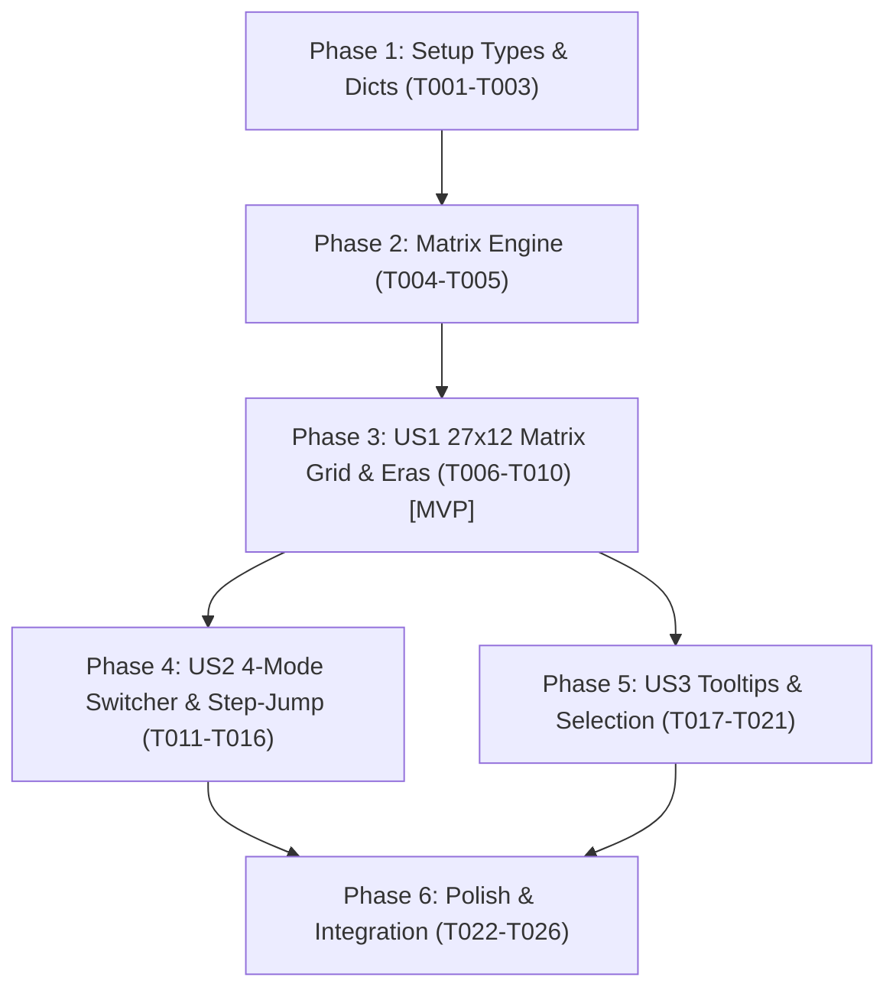

# Tasks: Interactive Burning Activity Calendar Matrix

**Input**: Design documents from `specs/006-burning-calendar-matrix/` (`spec.md`, `plan.md`, `data-model.md`, `contracts/`, `research.md`, `quickstart.md`)  
**Prerequisites**: `spec.md`, `plan.md`, `data-model.md`, `contracts/`  
**Tests**: Automated component tests requested in `SC-005` (Vitest + Testing Library)  
**Organization**: Tasks are grouped by user story to enable independent implementation and testing of each story.

---

## Format: `[ID] [P?] [Story] Description`

- **[P]**: Can run in parallel (different files, no dependencies)
- **[Story]**: Which user story this task belongs to (`[US1]`, `[US2]`, `[US3]`)
- Include exact file paths in descriptions

---

## Phase 1: Setup (Shared Infrastructure)

**Purpose**: Shared types, contracts, and bilingual dictionary extensions

- [X] T001 [P] Create matrix types and interfaces in `src/types/matrix.ts` following `specs/006-burning-calendar-matrix/contracts/burning-calendar-matrix.contract.ts` and `data-model.md`
- [X] T002 [P] Export new matrix types in `src/types/index.ts`
- [X] T003 [P] Extend bilingual dictionary with matrix headers, view modes, eras, marginal labels, and tooltips in `src/types/language.ts` and `src/context/LanguageContext.tsx`

---

## Phase 2: Foundational (Blocking Prerequisites)

**Purpose**: Core calculation engine for 27 × 12 matrix cells and marginal aggregates required before UI components mount

**⚠️ CRITICAL**: No user story UI implementation can begin until this phase is complete

- [X] T004 [P] Implement calendar matrix computation engine in `src/engine/calendarMatrix.ts` following `specs/006-burning-calendar-matrix/contracts/matrix-engine.contract.ts`
- [X] T005 Export new calendar matrix engine functions in `src/engine/index.ts`

**Checkpoint**: Core foundation ready — matrix cell generation and marginal statistics calculators available across components.

---

## Phase 3: User Story 1 - Multi-Decadal Matrix Grid & Sensor Era Synthesis (Priority: P1) 🎯 MVP

**Goal**: Deliver the primary 27-row (2000–2026) × 12-column (Jan–Dec) matrix grid with color-coded heatmap cells, sensor era grouping brackets, annual sums on the right margin, and monthly medians on the bottom margin.

**Independent Test**: Mount `BurningCalendarMatrix.tsx` inside `RegionProvider` and `LanguageProvider` for default region `PE-HCO`. Verify that 27 rows (2000–2026) are rendered, sensor era brackets (`MODIS Solo`, `Dual Fusion`, `VIIRS Continuity`) are delineated on the left, annual sums are displayed on the right, and monthly medians are displayed on the bottom.

### Tests for User Story 1 ⚠️

- [X] T006 [P] [US1] Create automated unit tests for 27 × 12 matrix grid mounting, sensor era partitions, and marginal row/column summaries in `tests/BurningCalendarMatrix.test.tsx`

### Implementation for User Story 1

- [X] T007 [US1] Implement core 27 × 12 CSS Grid layout with sticky Year labels and sensor era grouping brackets in `src/components/BurningCalendarMatrix.tsx`
- [X] T008 [US1] Implement right-margin annual sum column ($H_{\text{annual}}$) with proportional visual mini-bars in `src/components/BurningCalendarMatrix.tsx`
- [X] T009 [US1] Implement bottom-margin monthly baseline median row ($M_m$, 2001–2025) in `src/components/BurningCalendarMatrix.tsx`
- [X] T010 [US1] Verify User Story 1 tests pass via `pnpm test:run tests/BurningCalendarMatrix.test.tsx`

**Checkpoint**: At this point, User Story 1 (MVP) is fully functional and testable independently.

---

## Phase 4: User Story 2 - Analytical View Mode Switcher & Sensor Audit Step-Jump (Priority: P2)

**Goal**: Deliver the 4-mode analytical projection toolbar (`harmonized`, `anomaly`, `frp`, `raw`), automatic diverging palette lock for anomalies, and critical threshold alert badges ($P_{90}$ / $Z \ge 2.0$).

**Independent Test**: Use the view mode toolbar to toggle across the 4 projections. Verify that `anomaly` switches to the diverging blue-white-red palette centered at 0%, `frp` maps to Fire Radiative Power (MW), and `raw` visually exposes the artificial 2012 step-jump.

### Tests for User Story 2 ⚠️

- [X] T011 [P] [US2] Add unit tests for 4-mode projection switching, diverging palette lock, and critical anomaly badge rendering in `tests/BurningCalendarMatrix.test.tsx`

### Implementation for User Story 2

- [X] T012 [US2] Implement view mode toolbar buttons (`harmonized`, `anomaly`, `frp`, `raw`) with active states and tooltips in `src/components/BurningCalendarMatrix.tsx`
- [X] T013 [US2] Implement dynamic cell value formatting and automatic diverging palette enforcement for `anomaly` mode in `src/components/BurningCalendarMatrix.tsx`
- [X] T014 [US2] Implement critical anomaly alert badges ($P_{90}$ / $Z \ge 2.0$) on extreme fire cells in `src/components/BurningCalendarMatrix.tsx`
- [X] T015 [US2] Implement `raw` unharmonized mode visualization highlighting the 2012 sensor transition step-jump in `src/components/BurningCalendarMatrix.tsx`
- [X] T016 [US2] Verify User Story 2 tests pass via `pnpm test:run tests/BurningCalendarMatrix.test.tsx`

**Checkpoint**: User Stories 1 AND 2 are both functional and testable independently.

---

## Phase 5: User Story 3 - Interactive Cell Inspection, Tooltips & State Coordination (Priority: P3)

**Goal**: Deliver accessible floating tooltips on cell hover/focus with complete record telemetry, cell click selection with cyan/amber focus ring, and WAI-ARIA keyboard grid navigation.

**Independent Test**: Hover over any cell to verify the floating tooltip with full telemetry ($H_{y,m}$, $M_m$, $\Delta\%$, $Z$, FRP, $f_{\text{night}}$). Click a cell to verify focus ring and `onSelectRecord` dispatch. Navigate across cells using keyboard arrow keys.

### Tests for User Story 3 ⚠️

- [X] T017 [P] [US3] Add unit tests for cell hover tooltips, click selection callbacks, and keyboard arrow navigation in `tests/BurningCalendarMatrix.test.tsx`

### Implementation for User Story 3

- [X] T018 [US3] Implement accessible floating aerospace dark tooltip displaying complete month telemetry on cell hover/focus in `src/components/BurningCalendarMatrix.tsx`
- [X] T019 [US3] Implement interactive cell click selection with persistent cyan/amber focus ring and `onSelectRecord` dispatch in `src/components/BurningCalendarMatrix.tsx`
- [X] T020 [US3] Implement WAI-ARIA grid pattern (`role="grid"`, `role="row"`, `role="gridcell"`) with Arrow key navigation and Enter/Space selection in `src/components/BurningCalendarMatrix.tsx`
- [X] T021 [US3] Verify User Story 3 tests pass via `pnpm test:run tests/BurningCalendarMatrix.test.tsx`

**Checkpoint**: All three user stories are complete, accessible, and independently testable.

---

## Phase 6: Polish & Cross-Cutting Concerns

**Purpose**: End-to-end integration, strict typecheck, production build, and milestone documentation

- [X] T022 Re-export `BurningCalendarMatrix` from `src/components/index.ts`
- [X] T023 Mount `BurningCalendarMatrix.tsx` into `src/App.tsx` below `MapAOISelector` with responsive card container
- [X] T024 Update root integration tests in `tests/App.test.tsx` verifying calendar matrix rendering and region/mode reactivity
- [X] T025 Run full automated validation suite via `pnpm typecheck`, `pnpm test:run`, and `pnpm build`
- [X] T026 [P] Update version to `0.7.0` in `package.json` and document all additions and changes in `CHANGELOG.md` following Keep a Changelog

---

## Dependencies & Execution Order

### Phase Dependencies
- **Setup (Phase 1)**: No dependencies — executes immediately.
- **Foundational (Phase 2)**: Depends on Phase 1 completion — blocks all user stories.
- **US1 Matrix Grid (Phase 3)**: Depends on Phase 2 completion — delivers MVP.
- **US2 View Modes (Phase 4)**: Can start after US1 matrix grid is operational.
- **US3 Tooltips & Selection (Phase 5)**: Can start after US1 matrix grid is operational.
- **Polish (Phase 6)**: Runs full app integration and SemVer `0.7.0` documentation.

### Parallel Opportunities
- `T001` (`types/matrix.ts`), `T002` (`types/index.ts`), and `T003` (`types/language.ts`) can run in parallel in Phase 1.
- `T006`, `T011`, and `T017` (test suites) can be authored in parallel with their respective contract specifications.

---

## Implementation Strategy

### MVP First (User Story 1 Only)
1. Complete Phase 1 (Setup) + Phase 2 (Foundational Engine).
2. Complete Phase 3 (User Story 1: `BurningCalendarMatrix.tsx` 27 × 12 CSS Grid with sensor eras and marginal summaries).
3. Validate: User Story 1 displays the full multi-decadal heatmap matrix for any selected benchmark region.

### Incremental Delivery
1. Add User Story 2: 4-mode switcher (`harmonized`, `anomaly`, `frp`, `raw`) and critical alert badges.
2. Add User Story 3: Rich floating tooltips and interactive cell selection.
3. Integrate into `src/App.tsx`, run full test suite, and bump version to `0.7.0`.
