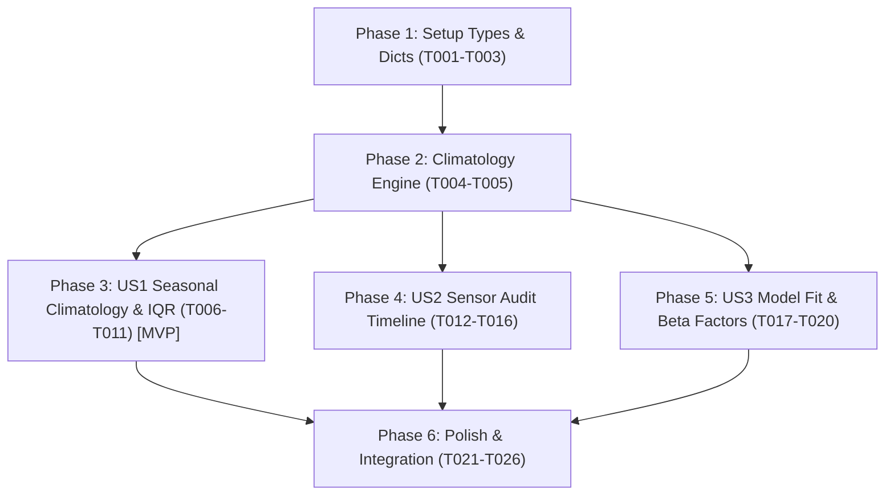

# Tasks: Climatological Anomaly Curves & Sensor Harmonization Audit Panels

**Input**: Design documents from `specs/007-climatology-sensor-audit/` (`spec.md`, `plan.md`, `data-model.md`, `contracts/`, `research.md`, `quickstart.md`)  
**Prerequisites**: `spec.md`, `plan.md`, `data-model.md`, `contracts/`  
**Tests**: Automated component tests requested in `SC-005` (Vitest + Testing Library)  
**Organization**: Tasks are grouped by user story to enable independent implementation and testing of each story.

---

## Format: `[ID] [P?] [Story] Description`

- **[P]**: Can run in parallel (different files, no dependencies)
- **[Story]**: Which user story this task belongs to (`[US1]`, `[US2]`, `[US3]`)
- Include exact file paths in descriptions

---

## Phase 1: Setup (Shared Infrastructure)

**Purpose**: Shared types, contracts, and bilingual dictionary extensions

- [X] T001 [P] Create climatology and audit types in `src/types/climatology.ts` following `specs/007-climatology-sensor-audit/contracts/` and `data-model.md`
- [X] T002 [P] Export new climatology types in `src/types/index.ts`
- [X] T003 [P] Extend bilingual dictionary with climatology chart titles, series labels, scorecards, and tooltips in `src/types/language.ts` and `src/context/LanguageContext.tsx`

---

## Phase 2: Foundational (Blocking Prerequisites)

**Purpose**: Core calculation and transformation engine required before chart components mount

**⚠️ CRITICAL**: No user story UI implementation can begin until this phase is complete

- [X] T004 [P] Implement climatology and audit data transform engine in `src/engine/climatologyEngine.ts` (`generateClimatologyCurveData`, `generateSensorAuditSeries`, `extractBetaFactorEntries`) following `specs/007-climatology-sensor-audit/contracts/climatology-engine.contract.ts`
- [X] T005 Export new climatology engine functions in `src/engine/index.ts`

**Checkpoint**: Core foundation ready — data transformers available across all chart components.

---

## Phase 3: User Story 1 - Seasonal Climatology & Anomaly Envelope Curve (Priority: P1) 🎯 MVP

**Goal**: Deliver the 12-month seasonal curve chart (`ClimatologyAnomalyChart.tsx`) with baseline median ($M_m$), shaded IQR envelope ($P_{25}\text{--}P_{75}$), critical $P_{90}$ threshold, active year trajectory, year dropdown, and aerospace dark tooltips.

**Independent Test**: Mount `ClimatologyAnomalyChart.tsx` inside `RegionProvider` and `LanguageProvider` for default region `PE-HCO`. Verify that 12 months are rendered, the IQR envelope is shaded between $P_{25}$ and $P_{75}$, $P_{90}$ is dashed, the active year trajectory connects months with colored anomaly dots, and changing the year selector dropdown updates the curve smoothly.

### Tests for User Story 1 ⚠️

- [X] T006 [P] [US1] Create automated unit tests for `ClimatologyAnomalyChart` mounting, curve rendering, year switching, and tooltip inspection in `tests/ClimatologyAnomalyChart.test.tsx`

### Implementation for User Story 1

- [X] T007 [US1] Implement `ClimatologyAnomalyChart.tsx` with Recharts `ResponsiveContainer`, `ComposedChart`, `Area` (IQR range), and `Line` (Median, $P_{90}$, and Active Year) in `src/components/ClimatologyAnomalyChart.tsx`
- [X] T008 [US1] Implement interactive Year Selector dropdown and header toolbar in `src/components/ClimatologyAnomalyChart.tsx`
- [X] T009 [US1] Implement aerospace dark hover tooltip with exact hotspot counts, baseline median, departure ($\Delta\%$), and robust $Z$-score in `src/components/ClimatologyAnomalyChart.tsx`
- [X] T010 [US1] Implement future month safeguard (Nov–Dec 2026 `connectNulls={false}`) and dynamic dot coloring based on anomaly status in `src/components/ClimatologyAnomalyChart.tsx`
- [X] T011 [US1] Verify User Story 1 tests pass via `pnpm test:run tests/ClimatologyAnomalyChart.test.tsx`

**Checkpoint**: At this point, User Story 1 (MVP) is fully functional and testable independently.

---

## Phase 4: User Story 2 - Sensor Harmonization Audit & Step-Jump Elimination (Priority: P2)

**Goal**: Deliver the multi-decadal timeline chart (`SensorHarmonizationAudit.tsx`) comparing raw MODIS, raw VIIRS, AFCD grid, and the final harmonized series across 2000–2026, visually exposing and explaining the 2012 step-jump.

**Independent Test**: Mount `SensorHarmonizationAudit.tsx`. Toggle series visibility checkboxes (*Raw MODIS*, *Raw VIIRS*, *AFCD Grid*, *Harmonized Curve*). Verify that enabling raw counts visually exposes the abrupt threefold vertical discontinuity in 2012, while the harmonized curve bridges the 2011–2012 boundary with smooth continuity.

### Tests for User Story 2 ⚠️

- [X] T012 [P] [US2] Create automated component tests for `SensorHarmonizationAudit` multi-decadal timeline rendering, layer toggles, and step-jump callout in `tests/SensorHarmonizationAudit.test.tsx`

### Implementation for User Story 2

- [X] T013 [US2] Implement multi-decadal time series chart with Recharts `LineChart` or `ComposedChart` in `src/components/SensorHarmonizationAudit.tsx`
- [X] T014 [US2] Implement interactive layer visibility toggles (`AuditLayerVisibility`) with active color badges in `src/components/SensorHarmonizationAudit.tsx`
- [X] T015 [US2] Implement 2012 sensor transition visual annotation callout (`ReferenceArea` / badge) explaining the artificial threefold step-jump and spatial resolution change ($1\text{ km} \rightarrow 375\text{ m}$) in `src/components/SensorHarmonizationAudit.tsx`
- [X] T016 [US2] Verify User Story 2 tests pass via `pnpm test:run tests/SensorHarmonizationAudit.test.tsx`

**Checkpoint**: User Stories 1 AND 2 are both functional and testable independently.

---

## Phase 5: User Story 3 - Model Fit Scorecards & Seasonal Calibration Factors ($\beta_m$) (Priority: P3)

**Goal**: Deliver 4 quantitative validation scorecards ($R^2 \ge 0.90$, Pearson $r$, MAPE reduction $\ge 65\%$, RMSE) and the 12-month regional calibration factor visual breakdown ($\beta_1 \dots \beta_{12}$).

**Independent Test**: Inspect model fit scorecards and monthly $\beta$ factors for Huánuco and switch regions. Verify that all 4 cards display valid statistical metrics and that 12 monthly bars reflect regional seasonal scaling ratios.

### Tests for User Story 3 ⚠️

- [X] T017 [P] [US3] Add unit tests for statistical scorecard values and 12 $\beta$ factor rendering in `tests/SensorHarmonizationAudit.test.tsx`

### Implementation for User Story 3

- [X] T018 [US3] Implement 4 statistical model fit scorecard cards ($R^2$, Pearson $r$, MAPE reduction, RMSE) in `src/components/SensorHarmonizationAudit.tsx`
- [X] T019 [US3] Implement 12-month regional calibration factor visual breakdown bar chart / card grid ($\beta_1 \dots \beta_{12}$) in `src/components/SensorHarmonizationAudit.tsx`
- [X] T020 [US3] Verify User Story 3 tests pass via `pnpm test:run tests/SensorHarmonizationAudit.test.tsx`

**Checkpoint**: All three user stories are complete, accessible, and independently testable.

---

## Phase 6: Polish & Cross-Cutting Concerns

**Purpose**: End-to-end integration, bidirectional synchronization, strict typecheck, production build, and milestone documentation

- [X] T021 Re-export `ClimatologyAnomalyChart` and `SensorHarmonizationAudit` from `src/components/index.ts`
- [X] T022 Mount `ClimatologyAnomalyChart` and `SensorHarmonizationAudit` into `src/App.tsx` below `BurningCalendarMatrix` with responsive card containers and tab/stacked layout
- [X] T023 Wire bidirectional state synchronization between `BurningCalendarMatrix` cell click and `ClimatologyAnomalyChart` active year in `src/App.tsx`
- [X] T024 Update root integration tests in `tests/App.test.tsx` verifying chart mounting and state synchronization
- [X] T025 Run full automated validation suite via `pnpm typecheck`, `pnpm test:run`, and `pnpm build`
- [X] T026 [P] Update version to `0.8.0` in `package.json` and document all additions and changes in `CHANGELOG.md` following Keep a Changelog

---

## Dependencies & Execution Order

### Phase Dependencies
- **Setup (Phase 1)**: No dependencies — executes immediately.
- **Foundational (Phase 2)**: Depends on Phase 1 completion — blocks all user stories.
- **US1 Climatology Curve (Phase 3)**: Depends on Phase 2 completion — delivers MVP.
- **US2 Sensor Audit (Phase 4)**: Can start after Phase 2 completion.
- **US3 Model Fit & Beta (Phase 5)**: Can start after Phase 2 completion (shares component with US2).
- **Polish (Phase 6)**: Runs full app integration and SemVer `0.8.0` documentation.

### Parallel Opportunities
- `T001` (`types/climatology.ts`), `T002` (`types/index.ts`), and `T003` (`types/language.ts`) can run in parallel in Phase 1.
- `T006`, `T012`, and `T017` (test suites) can be authored in parallel with their respective contracts.
- Once Foundational (Phase 2) is complete, US1 and US2/US3 can be implemented in parallel.

---

## Implementation Strategy

### MVP First (User Story 1 Only)
1. Complete Phase 1 (Setup) + Phase 2 (Foundational Engine).
2. Complete Phase 3 (User Story 1: `ClimatologyAnomalyChart.tsx` with IQR envelope, median line, $P_{90}$ threshold, and active year trajectory).
3. Validate: User Story 1 displays the seasonal climatology curve for any selected year and benchmark region.

### Incremental Delivery
1. Add User Story 2: `SensorHarmonizationAudit.tsx` multi-decadal timeline with layer toggles and 2012 step-jump callout.
2. Add User Story 3: Model fit scorecards ($R^2 \ge 0.90$, MAPE reduction $\ge 65\%$) and 12-month $\beta_m$ factor visual breakdown.
3. Integrate into `src/App.tsx`, wire bidirectional sync with `BurningCalendarMatrix`, run full test suite, and bump version to `0.8.0`.
