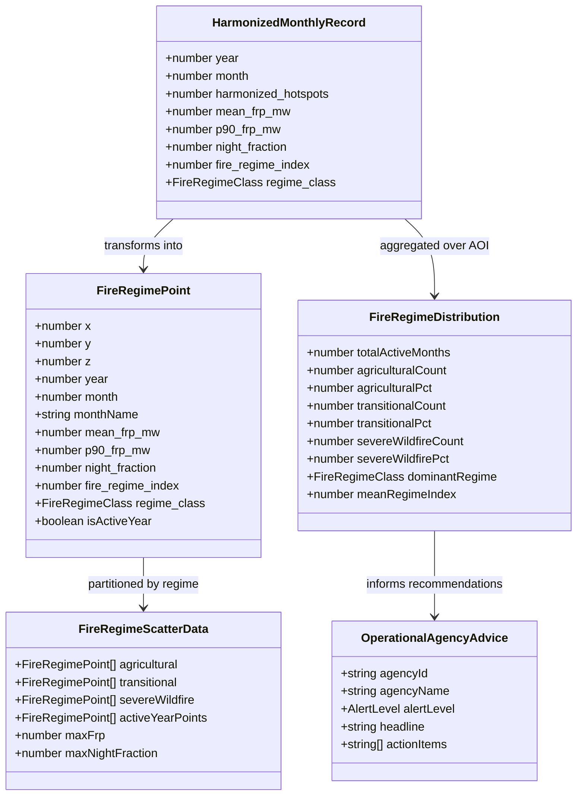

# Data Model: Fire Regime Diagnostic Classifier (`FireRegimePanel.tsx`)

**Branch**: `feat/T-09-fire-regime-classifier`  
**Date**: 2026-11-15  
**Spec Reference**: [`specs/008-fire-regime-classifier/spec.md`](spec.md)

---

## 1. Entity Overview & Type Architecture



---

## 2. Core Entities & TypeScript Definitions

### 2.1 `FireRegimePoint`
Represents an individual monthly observation formatted specifically for Recharts scatter plots:

```typescript
export interface FireRegimePoint {
  x: number; // Mean FRP in MW (mapped to X-axis)
  y: number; // Night Fraction f_night in [0, 1] (mapped to Y-axis)
  z: number; // Harmonized hotspots H_{y,m} (mapped to bubble volume/radius)
  year: number; // Observation year (2000 - 2026)
  month: number; // Month index (1 - 12)
  monthName: string; // "Jan", "Feb", etc.
  mean_frp_mw: number; // Original mean FRP
  p90_frp_mw: number; // 90th percentile FRP
  night_fraction: number; // Exact nocturnal fraction
  fire_regime_index: number; // I_{regime} (0 - 100)
  regime_class: FireRegimeClass; // 'AGRICULTURAL_BURN' | 'TRANSITIONAL' | 'SEVERE_WILDFIRE'
  isActiveYear: boolean; // True if observation matches currently selected year
}
```

### 2.2 `FireRegimeScatterData`
Partitioned scatter dataset consumed directly by Recharts `ScatterChart`:

```typescript
export interface FireRegimeScatterData {
  agricultural: FireRegimePoint[];
  transitional: FireRegimePoint[];
  severeWildfire: FireRegimePoint[];
  activeYearPoints: FireRegimePoint[];
  maxFrp: number; // Maximum observed Mean FRP for dynamic axis scaling
  maxNightFraction: number; // Maximum observed Night Fraction
}
```

### 2.3 `FireRegimeDistribution`
Statistical summary of regime frequency across all historical fire months for an AOI:

```typescript
export interface FireRegimeDistribution {
  totalActiveMonths: number;
  agriculturalCount: number;
  agriculturalPct: number; // 0 - 100
  transitionalCount: number;
  transitionalPct: number; // 0 - 100
  severeWildfireCount: number;
  severeWildfirePct: number; // 0 - 100
  dominantRegime: FireRegimeClass;
  meanRegimeIndex: number; // 0 - 100
}
```

### 2.4 `OperationalAgencyAdvice`
Targeted mitigation guidance for operational agencies:

```typescript
export type AgencyId = 'civil_defense' | 'park_rangers' | 'agricultural';

export type AlertLevel = 'ADVISORY' | 'WARNING' | 'EMERGENCY';

export interface OperationalAgencyAdvice {
  agencyId: AgencyId;
  agencyName: string;
  alertLevel: AlertLevel;
  headline: string;
  actionItems: string[];
}

export interface FireRegimeMitigationPackage {
  postureLevel: AlertLevel;
  activeYear: number;
  peakRegime: FireRegimeClass;
  peakRegimeIndex: number;
  agencies: OperationalAgencyAdvice[];
}
```

---

## 3. Transformation & Business Logic Rules

1. **Filtering Inactive Months:**
   - Any record where `harmonized_hotspots === 0` is excluded from the scatter plot and distribution calculations to avoid false zero-clustering.
2. **Dynamic Domain Bounds:**
   - X-Axis (`Mean FRP`):
     $$\text{domainMax} = \max(100, \lceil \max(\text{FRP}) / 10 \rceil \times 10)$$
   - Y-Axis (`Night Fraction`):
     $$\text{domainMax} = \max(0.40, \min(1.0, \lceil \max(f_{\text{night}}) \times 10 \rceil / 10))$$
3. **Distribution Percentages:**
   - Percentages are computed relative to `totalActiveMonths` (excluding months with zero fires), rounded to 1 decimal place, ensuring $\sum \% \approx 100\%$.
4. **Active Year Peak Posture:**
   - The mitigation alert posture is determined by the maximum `fire_regime_index` and worst `regime_class` observed during the active year:
     - `SEVERE_WILDFIRE` or $I_{\text{regime}} \ge 65 \implies \text{EMERGENCY}$
     - `TRANSITIONAL` or $35 \le I_{\text{regime}} < 65 \implies \text{WARNING}$
     - `AGRICULTURAL_BURN` and $I_{\text{regime}} < 35 \implies \text{ADVISORY}$
