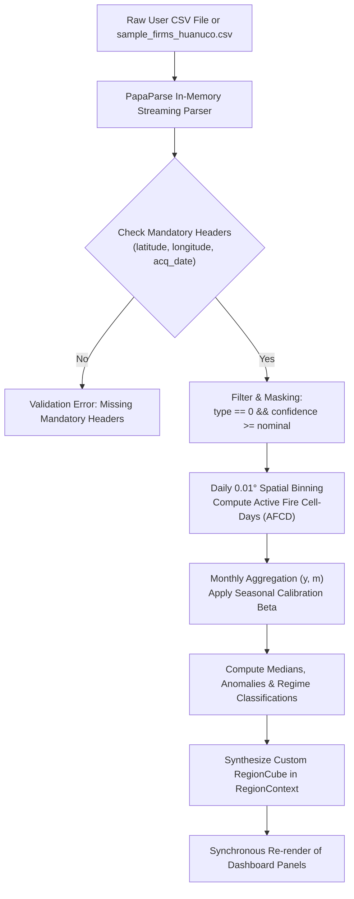

# Data Model: Standardized CSV Exporter & Custom FIRMS Ingestion

**Feature**: Standardized CSV Exporter and Custom NASA FIRMS CSV Ingestion (`T-10`)  
**Directory**: `specs/009-csv-export-upload`  
**Date**: 2026-11-15  

---

## 1. Entities & Data Contracts

### 1.1 `StandardizedHarmonizedRow`
Represents a single monthly record in the canonical 27-column CSV export conforming to NASA Space Apps Challenge 15 Requirement R7 and Microsoft Planetary Computer STAC conventions:

```typescript
export interface StandardizedHarmonizedRow {
  // Spatial STAC Metadata (Columns 1-6)
  aoi_id: string;                      // e.g. "PE-HCO"
  aoi_name: string;                    // e.g. "Huanuco & Central Peruvian Andes"
  bbox_min_lat: number;                // e.g. -10.60
  bbox_max_lat: number;                // e.g. -8.40
  bbox_min_lon: number;                // e.g. -77.10
  bbox_max_lon: number;                // e.g. -74.40

  // Temporal Metadata (Columns 7-10)
  year: number;                        // 2000 to 2026
  month: number;                       // 1 to 12
  month_name: string;                  // "January", "February", etc.
  sensor_era: 'MODIS_ERA' | 'DUAL_SENSOR_FUSION' | 'VIIRS_CONTINUITY';

  // Sensor Counts & Grid-Cell Days (Columns 11-14)
  raw_modis_hotspots: number;          // Raw uncalibrated MODIS C6.1 detections
  raw_viirs_hotspots: number;          // Raw uncalibrated VIIRS 375m C2 detections
  modis_grid_cell_days: number;        // AFCD on 0.01 deg daily grid
  viirs_grid_cell_days: number;        // AFCD on 0.01 deg daily grid

  // Calibration & Harmonization (Columns 15-16)
  seasonal_beta_factor: number;        // Monthly scaling ratio beta_m (e.g. 1.81)
  harmonized_hotspots: number;         // Unified cross-sensor count H_{y,m}

  // Climatological Baselines & Thresholds (Columns 17-19)
  historical_median_2001_2025: number; // Multi-year monthly median M_m
  iqr_25_75: number;                   // Interquartile range (Q3 - Q1)
  p90_critical_threshold: number;      // 90th percentile threshold

  // Anomaly Analytics (Columns 20-22)
  anomaly_percent: string;             // Formatted with explicit sign (e.g. "+77.17%")
  robust_z_score: number;              // (H_{y,m} - M_m) / NIQR
  anomaly_status: 'NORMAL' | 'ELEVATED' | 'CRITICAL_ANOMALY';

  // Fire Radiative Power & Regime Diagnostics (Columns 23-27)
  mean_frp_mw: number;                 // Mean Fire Radiative Power in MW
  p90_frp_mw: number;                  // 90th percentile FRP in MW
  night_detection_fraction: number;    // Ratio of nocturnal detections (0.0 to 1.0)
  fire_regime_index: number;           // Composite index (0 to 100)
  fire_regime_classification: 'SEASONAL_AGRICULTURAL' | 'MIXED_TRANSITIONAL' | 'SEVERE_WILDFIRE';
}
```

---

### 1.2 `RawFIRMSPoint`
Represents an individual hotspot detection parsed from an ingested NASA FIRMS CSV file:

```typescript
export interface RawFIRMSPoint {
  latitude: number;
  longitude: number;
  brightness?: number;                 // MODIS Band 21/22 or VIIRS I4 brightness temp (K)
  scan?: number;                       // Scan pixel footprint size (km)
  track?: number;                      // Track pixel footprint size (km)
  acq_date: string;                    // "YYYY-MM-DD"
  acq_time?: string | number;          // "HHMM" or UTC minutes
  satellite?: string;                  // "Terra", "Aqua", "N", "N20", "N21"
  instrument?: string;                 // "MODIS" or "VIIRS"
  confidence?: string | number;        // MODIS 0-100 or VIIRS 'l'/'n'/'h'
  version?: string;                    // e.g. "6.1", "2.0NRT"
  bright_t31?: number;                 // TIR band brightness temp (K)
  frp?: number;                        // Fire Radiative Power (MW)
  daynight?: 'D' | 'N';                // Daytime or Nighttime flag
  type?: number;                       // 0=vegetation, 1=volcano, 2=static flare, 3=offshore
}
```

---

### 1.3 `FIRMSValidationReport`
Detailed diagnostic report generated by the parser for user inspection inside `CustomCSVModal.tsx`:

```typescript
export interface FIRMSValidationReport {
  isValid: boolean;
  fileName: string;
  fileSizeBytes: number;
  totalRows: number;
  validVegetationHotspots: number;
  excludedRows: {
    nonVegetationType: number;        // type != 0
    lowConfidence: number;            // MODIS < 30% or VIIRS 'l'
    invalidCoordinates: number;       // NaN, out of range
    missingDate: number;              // invalid YYYY-MM-DD
  };
  detectedSensors: string[];          // e.g. ["MODIS (Terra/Aqua)", "VIIRS (Suomi-NPP)"]
  dateRange: {
    startDate: string;                // Earliest acq_date
    endDate: string;                  // Latest acq_date
  };
  boundingBox: {
    minLat: number;
    maxLat: number;
    minLon: number;
    maxLon: number;
  };
  errorMessages: string[];
  warningMessages: string[];
}
```

---

### 1.4 `CustomHarmonizedCube`
Synthesized in-memory data cube adhering to the project's `RegionCube` interface:

```typescript
// Defined in src/types/cube.ts
export interface RegionCube {
  id: string;                         // e.g. "CUSTOM-UPLOAD"
  name: string;                       // e.g. "Custom Ingested FIRMS Dataset"
  bbox: [number, number, number, number]; // [minLat, minLon, maxLat, maxLon]
  center: [number, number];           // [lat, lon]
  temporal_coverage: {
    start_year: number;
    end_year: number;
  };
  seasonal_beta: Record<string, number>; // Monthly beta ratios ("1" -> 1.81, etc.)
  monthly_series: MonthlyRecord[];
}
```

---

## 2. Ingestion & Transformation Pipeline


